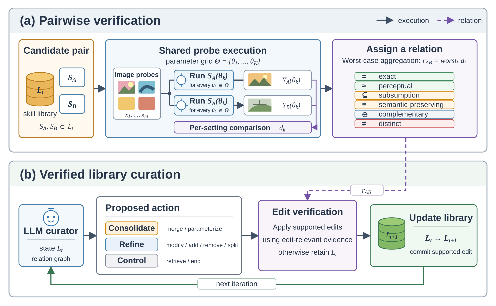
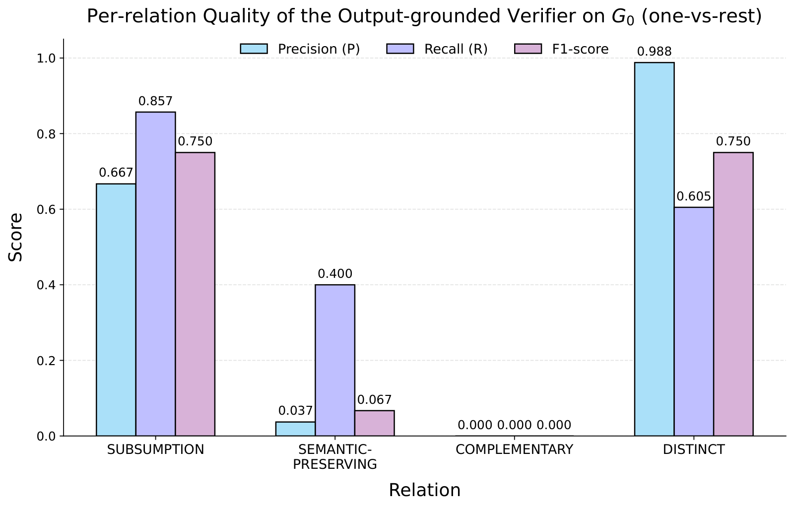
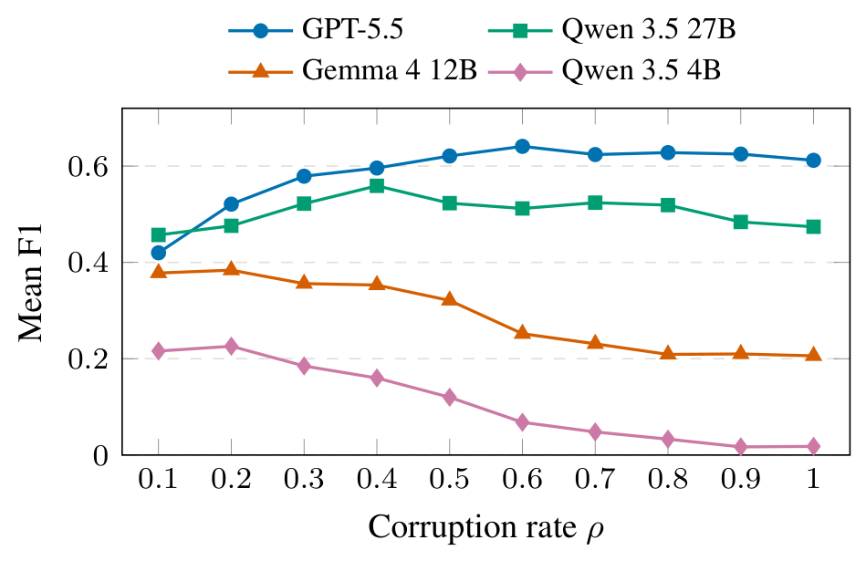
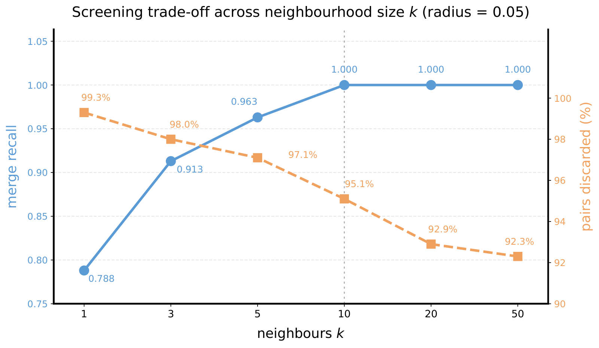
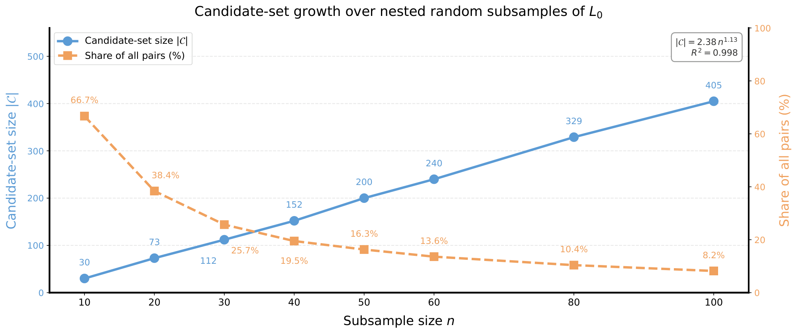

<div align="center">

# VisCurate: Evaluating Behavioral Equivalence of Visual Skills

**Md Farhan Ishraq**<sup>1</sup> · **Md Farhan Ishmam**<sup>2</sup> · **Reaz Hassan Joarder**<sup>1</sup> · **Md Hasanul Kabir**<sup>1</sup>

<sup>1</sup>Islamic University of Technology &nbsp;&nbsp; <sup>2</sup>University of Utah

**WACV 2027**

[**Project Page**](https://farhanishraq17.github.io/Viscurate-Website/) &nbsp;·&nbsp; [**BibTeX**](#citation)

</div>

<p align="center">
  
</p>

<p align="center"><sub><b>Overview of the VisCurate pipeline.</b> (a) A noisy seed skill library is evaluated through an output-grounded equivalence verifier, which executes candidate skills on shared probes and certifies their behavioral relations from the resulting outputs. (b) These verified relations guide the structural edits proposed by the curation agent, which are validated before updating the library. The process repeats until a compact and organized skill library is produced.</sub></p>

## Abstract

Modern vision-based agents have shifted toward skill-based problem-solving, where a skill is an
executable image-to-image operation, e.g., cropping, thresholding, or edge detection. As these skill
libraries grow, they accumulate duplicated, mislabeled, and defective skills. The signals normally used
to curate them (a skill's name, description, or source code) say little about how the skill visually
changes the image. We present **VisCurate**, a framework and benchmark that curates visual skill
libraries from observed execution rather than from text. VisCurate runs each candidate skill pair on a
shared probe battery and assigns one of six behavioral relations, each tied to a library edit that is
safe to make. The benchmark injects seven defect types into a clean library at controlled rates,
producing 300 reproducible instances with ground-truth relations and repairs. While text baselines
accept up to five of six false merges on hard negatives, our verifier accepts none and recovers 51.2% of
the pairs that are truly mergeable. On two real, uncurated libraries, VisCurate finds that 92% of the
skills a package shares with its downstream copy are redundant, while execution confirms only 10 of 17
published equivalence claims. The curation problem also remains open, as the strongest of the nine
automated curators recovers only about half of the repairs. We emphasize that visual skill libraries
should be curated by behavior, not by description.

## Key Findings

- **Text and code are not safe proxies for behavior.** Name matching and sentence embeddings each
  accept five of the six possible false merges on the hard negatives; the output-grounded verifier
  accepts none.
- **Safety holds at every corruption rate.** The verifier finds 51.2% of truly mergeable pairs and makes
  no false merges at any corruption rate ρ, so safety does not decay as the library gets dirtier.
- **The misses sit one threshold away.** Almost all missed merges are PERCEPTUAL pairs labeled
  SEMANTIC-PRESERVING, one conservative notch below a merge.
- **Real libraries carry hidden redundancy.** 92% of the filters a package shares with its downstream
  copy are exactly redundant, while only 10 of 17 published equivalence claims survive execution.
- **Curation remains an open problem.** The strongest of nine curators, GPT-5.5, recovers only about
  half of the required repairs, and Llama 3.2 1B never produces a correct action.
- **Output screening scales near-linearly.** The candidate count fits |C| = 2.38 n<sup>1.13</sup>
  (R² = 0.998) against quadratic exhaustive pairing, and 54.9% of pairs are settled before any learned
  backend runs.

## Contents

- [Method](#method)
- [Benchmark](#benchmark)
- [Results](#results)
- [Limitations](#limitations)
- [Getting Started](#getting-started)
- [Repository Structure](#repository-structure)
- [Citation](#citation)
- [Acknowledgements](#acknowledgements)
- [License](#license)

---

## Method

### Problem formulation

Let 𝓘 denote the space of images across resolutions and channel layouts. A **skill** is a tuple
*s* = ⟨*k*, *μ*, *d*, *f<sub>s</sub>*, Θ<sub>s</sub>⟩: an identifier *k*, a textual name *μ*, a
natural-language description *d*, a deterministic visual transformation
*f<sub>s</sub>* : 𝓘 × Θ<sub>s</sub> → 𝓘, and a typed parameter schema Θ<sub>s</sub>. Seeded-stochastic
skills take the seed as part of the input, which makes them deterministic conditioned on it. A
**relation graph** *G* = (*L*, *E*) labels each skill pair with a relation from the equivalence
taxonomy.

Similar descriptions can hide different outputs, causing a **silent merge**, while different
implementations can behave identically, causing a **missed consolidation**. VisCurate therefore
compares executed outputs instead of descriptors. For a probe battery *B* = (*x*<sub>1</sub>, …,
*x<sub>m</sub>*) spanning image content, channel layouts, bit depths and degenerate cases, the
**behavioral signature** of a skill at parameter value *θ* is

```math
\sigma(s,\theta)=\big(\phi(f_s(x_1,\theta)),\,\dots,\,\phi(f_s(x_m,\theta))\big),
```

where *φ* canonicalizes outputs, removing differences in channel layout, format or encoding so that
distance reflects behavior rather than storage. Instead of asking whether two skills are equivalent,
VisCurate asks whether their signatures agree under a relation-specific metric.

### Worst-case aggregation over a parameter grid

Because most skills are parameterized, VisCurate never compares at a single operating point. It
evaluates both skills over a matched grid Θ<sup>grid</sup> ⊆ Θ<sub>s<sub>a</sub></sub> ∩
Θ<sub>s<sub>b</sub></sub> and aggregates by the worst case:

```math
D(s_a,s_b)=\max_{\theta\in\Theta^{\mathrm{grid}}}\;\frac{1}{m}\sum_{i=1}^{m} d\Big(\phi\big(f_{s_a}(x_i,\theta)\big),\,\phi\big(f_{s_b}(x_i,\theta)\big)\Big)
```

The worst case is what blocks spurious merges between skills that coincide on part of their domain: a
Gaussian blur and a box blur agree at small kernels but diverge at large ones, and the max over the
grid surfaces that divergence rather than averaging it away. Two safeguards keep the comparison
reliable: a shape check sets *d* = ∞ whenever two outputs differ in spatial extent, and a content hash
over the canonical form fires only for byte-identical outputs.

### The equivalence taxonomy

Each ordered pair receives exactly one relation. The classifier is **hierarchical and stop-at-first**:
it evaluates relations cheapest-and-strictest first and returns the first that holds, so a stronger,
more actionable relation is never masked by a weaker one. Perceptual distance uses LPIPS; semantic
distance uses DINO ViT and CLIP feature spaces.

| Check | Relation | Certified when (from outputs only) | Permitted edit |
|:---:|---|---|---|
| 1 | **= Exact** | outputs are identical across the battery at every shared parameter setting, up to an L∞ tolerance ε | merge |
| 2 | **≈ Perceptual** | worst-case LPIPS below τ<sub>pc</sub>, with an SSIM floor guarding LPIPS blind spots | merge |
| 3 | **⊆ Subsumption** | some setting of *s<sub>b</sub>* reproduces every setting of *s<sub>a</sub>* within perceptual tolerance (directional) | parameterize |
| 4 | **≡ Semantic-preserving** | DINO cosine distance (p90, cross-checked against the mean) below τ<sub>sm</sub> | parameterize, never merge |
| 5 | **≠ Distinct** | none of the above (default by elimination) | keep separate |
| abstain | **? Uncertain** | the deciding distance clears a threshold by less than the band δ | human review |
| advisory | **⊕ Complementary** | both skills are non-trivial and compose into a meaningful pipeline (executed composition-effect test) | advisory only |

```text
Algorithm 1  Classifying an output pair (s_a, s_b)
Require: tolerances ε, τ_pc, τ_sm and band δ
  if   D_ex ≤ ε                          return EXACT
  elif D_pc ≤ τ_pc and SSIM floor holds  return PERCEPTUAL
  elif D_pc ≤ τ_pc + δ                   return UNCERTAIN
  elif s_a ⊑ s_b or s_b ⊑ s_a            return SUBSUMPTION
  elif D_sm ≤ τ_sm                       return SEMANTIC-PRESERVING
  elif D_sm ≤ τ_sm + δ                   return UNCERTAIN
  else                                   return DISTINCT
```

Three skill classes are handled explicitly: **seeded-stochastic** skills (e.g., additive noise) are
compared only at matched seeds, **precision-sensitive** skills (e.g., FFT round-trips) with perceptual
rather than exact tolerance, and **platform-sensitive** skills (e.g., seeded *k*-means quantization)
within a single platform.

**Calibrated operating point.** Thresholds are fit on a cluster-disjoint split of 713 pairs from eight
operator families, maximizing precision on non-equivalence under a recall floor, and are frozen before
evaluation.

| Threshold | Value | Role |
|---|:---:|---|
| ε (exact L∞) | 1/255 | numerical-equality tolerance |
| τ<sub>pc</sub> (LPIPS) | 0.05 | worst-case perceptual bound |
| SSIM floor (1 − SSIM) | 0.10 | LPIPS blind-spot guard |
| τ<sub>sm</sub> (DINO, p90) | 0.15 | semantic-preserving bound |
| complementary (LPIPS) | 0.05 | composition-effect tolerance |
| abstention δ | 0.05 | UNCERTAIN-band width |

### Verified library curation

A corrupted library is the environment of a partially observable Markov decision process whose hidden
state is the set of injected defects. The curation agent, a frozen language model used as-is, is a
policy over the observable history that proposes actions from a fixed set. Every structural edit
passes a **verifier check that belongs to the environment, not to the agent**: an edit takes effect
only if the output-grounded verifier certifies a relation that permits it. Episodes are scored against
an ideal-action key derived from the injected defects, by an oracle reward the agent never observes.

| Action | Meaning |
|---|---|
| `add` | add a new skill |
| `remove` | remove a skill |
| `modify` | modify metadata/schema or function behavior |
| `retrieve` | retrieve/query a skill |
| `merge` | merge redundant skills |
| `split` | split one skill into multiple skills |
| `parameterize` | fold a specialization into a more general parameterized skill |
| `end` | stop the episode |

Rejected edits carry a structured reason (the relation, the deciding distances and the admissible
alternatives) and still consume budget. Agent-authored code runs only inside a hardened sandbox, and
candidate pairs are proposed by a cheap **output-derived fingerprint** (a perceptual hash plus a mean
DINO feature on a screening sub-battery), so the pipeline stays text-blind end to end.

---

## Benchmark

**Base library.** A hand-authored clean library *L*<sub>0</sub> of **100 skills** spans
geometric/canvas, photometric, signal/morphology, and mask/reconstruction families. Its designed
ground-truth relation graph *G*<sub>0</sub> enumerates **944 ordered pairs**, is validated for DAG and
transitive-closure consistency, and is fixed before any metric runs. It embeds directional
subsumptions, complementary pairs, and engineered hard negatives (e.g., Gaussian vs. box blur, nearest
vs. bilinear vs. bicubic resize) that must not be merged.

**Probe battery.** **177 license-clean probes**: 137 CC0 synthetic images (textures, gradients, shapes,
documents, noise, colour charts and degenerate cases such as 1×1 and single-colour images) and 40 COCO
test2017 photographs, covering grayscale, RGB, RGBA, 16-bit and palette formats.

**Corruption.** Seven defect types are implemented as named, replayable function factories:

| # | Defect | Effect | Ideal repair |
|:---:|---|---|---|
| 1 | Implementation bug | silently corrupts outputs | `remove` |
| 2 | Metadata mislead | rewrites name and description; behavior intact | `modify` |
| 3 | Duplicate | exact or perceptual copy under a new identifier | `merge` |
| 4 | Subsumption | fixed-parameter specialization of a more general skill | `parameterize` |
| 5 | Parameter-schema drift | corrupts a parameter default | `modify` |
| 6 | Domain-scoped bug | misbehaves only on some inputs | `modify` |
| 7 | Dead/identity skill | adds a skill that is never needed | `remove` |

A deterministic planner apportions the defect budget under a composition vector (uniform,
duplicate-heavy, metadata-heavy), and a pure replay of the corruption log reconstructs the corrupted
library *L*<sub>ρ</sub>, its relation graph *G*<sub>ρ</sub>, and the ideal-action key. Corrupted
skills masquerade as built-in, so a defect is observable only through behavior.

```text
ρ ∈ {0.1, …, 1.0}  ×  3 compositions  ×  5 seeds  ×  {single, mixed}  =  300 reproducible instances
```

**Curation protocol.** Each agent works through one episode per instance with a budget of **200
actions** and sees only redacted skill summaries. During the agent study the verifier runs in its
deterministic configuration with learned backends switched off, the most conservative merge policy, so
all 2,700 episodes replay exactly and every agent sees the same 300 instances.

---

## Results

The evaluation is organized around five research questions.

| | Question |
|---|---|
| **RQ1** | Do names, descriptions, or source code tell us how a skill behaves? |
| **RQ2** | How many of the truly redundant pairs does the verifier find, and how often does it get one wrong? |
| **RQ3** | Does that result hold on a larger set of hard negatives? |
| **RQ4** | Does the framework carry over to real, uncurated libraries? |
| **RQ5** | How well do LLM-based agents curate a decaying library, and what does it cost? |

### RQ1 · Text and code do not predict visual behavior

Since *G*<sub>0</sub> designates no true duplicates, every merge proposed on it is false by
construction. Each method is evaluated at a matched operating point on all 944 designed pairs.

| Method | Reads | FPR<sub>dist</sub> (%) ↓ | FM<sub>hard</sub> ↓ |
|---|---|:---:|:---:|
| Name match | name | 5.40 | 5 |
| TF–IDF cosine | description | 0.21 | 0 |
| Sentence embedding | description | 5.61 | 5 |
| Code embedding | source | 1.80 | 4 |
| AST (structural) | source | 0.00 | 0 |
| AST (semantic) | source | 0.00 | 0 |
| LLM judge | description | 0.11 | 1 |
| LLM judge | source | — | 0 |
| **VisCurate (ours)** | **outputs** | **0.00** | **0** |

<sub>FPR<sub>dist</sub>: false-merge rate on truly-DISTINCT pairs. FM<sub>hard</sub>: false merges accepted on the six engineered hard negatives. VisCurate abstains on 1.5% of decisions; no baseline abstains. The source-reading LLM judge is scored on a 120-pair subsample (mean of three repeats), so its FPR is omitted.</sub>

- **Surface similarity over-merges.** Name matching and sentence embeddings each accept five of the six
  possible false merges on the hard negatives, and the code embedding accepts four.
- **Stronger baselines stay structurally blind.** Every method except VisCurate emits only a
  merge-vs-distinct split, so none can represent the subsumption direction, semantic preservation, or
  complementarity, and no text method is sensitive to the metadata-mislead defect.
- **Source code fails in both directions at once.** A delegating wrapper executes identically to its
  donor yet shares almost no source with it, while wrappers of unrelated skills are nearly identical as
  source. On one fully corrupted instance, 25.7% of cross-original clone pairs are byte-identical in
  source while wrapping different skills.

<p align="center">
  
</p>
<p align="center"><sub>Per-relation precision, recall, and F1 of the output-grounded verifier on <i>G</i><sub>0</sub> (one-vs-rest). EXACT and PERCEPTUAL have no support in a clean reference graph and are omitted.</sub></p>

Only the verifier resolves the full behavioral taxonomy. SUBSUMPTION, the relation behind
parameterization, is recovered well (F1 0.750). SEMANTIC-PRESERVING is the weak point (precision
0.037), though it is not a safety failure: the distinct pairs it misses carry labels that permit no
merging.

### RQ2 · Redundancy recovered by the verifier

The corrupted graphs *G*<sub>ρ</sub> carry known relations by construction, including injected
duplicates, so they support what *G*<sub>0</sub> cannot: measuring how much real redundancy the
verifier recovers. Replaying the verifier over all 300 instances scores **13,658 labeled pairs** with
**3,310 truly mergeable positives**, zero unresolved execution errors, and zero verdict disagreements
across re-run shards.

| Relation | Support | Recall | Precision |
|---|---:|:---:|:---:|
| Exact | 1,640 | 0.968 | 1.000 |
| Perceptual | 1,670 | 0.046 | 0.704 |
| Subsumption | 4,672 | 0.758 | 0.996 |
| Semantic-preserving | 3,424 | 0.319 | 0.278 |
| Complementary | 310 | 0.000 | 0.000 |
| Distinct | 1,942 | 0.384 | 0.188 |

<sub>The binary merge decision scores recall 0.512 (exact 95% CI [0.495, 0.530]) at precision 1.000 (TP/FP/FN = 1,696 / 0 / 1,614).</sub>

- **Safety holds everywhere.** The verifier finds 51.2% of the truly mergeable pairs and makes no false
  merges. The count stays at zero at each corruption rate taken on its own, so safety does not decay as
  the library gets dirtier.
- **The misses sit one threshold away.** Byte-identical duplicates are found almost always (EXACT
  recall 0.968) and near-duplicates almost never (PERCEPTUAL recall 0.046), because 1,594 of 1,670
  PERCEPTUAL pairs are labeled SEMANTIC-PRESERVING, one conservative notch below the label that would
  allow their merge.

### RQ3 · Scaling hard negatives

On six pairs, a perfect 0/6 bounds the false-merge rate only at 39% (one-sided 95%). Expanding the
slice to **69 engineered pairs** spanning the same trap families (resampling kernels, border modes,
quantization variants), the verifier makes **0/69 false merges**, and pairs checked independently by
more than one shard agree in every case.

### RQ4 · Performance on real libraries

With thresholds frozen, the verifier is applied to two real, uncurated libraries.

- **Cross-version.** [`pilgram` 2.0.0](https://github.com/akiomik/pilgram/tree/v2.0.0) and its
  downstream copy [`pilgram2` 2.0.10](https://github.com/mgineer85/pilgram2/tree/v2.0.10) share 25
  filter names, and neither package has a way to find the overlap. **23 of 25** shared filters are
  byte-identical on all 177 probes and certified EXACT, so 92% of the shared surface can be merged. The
  other two have genuinely diverged and are correctly not merged; one differs visibly (LPIPS 0.246) yet
  is semantically indistinguishable (DINO p90 0.0008), so a perceptual-only test would call it
  divergent while a semantic-only test would merge it.
- **Cross-library.** Corpus A holds 93 implementations of common operations across 20 families from
  OpenCV, PIL, scikit-image, torchvision, Kornia and Albumentations, giving 182 within-family pairs.
  Published documentation tables group 17 of these pairs as directly equivalent, yet execution
  certifies only **10 of 17** (0.588, exact 95% CI [0.33, 0.82]) as mergeable at aligned parameters,
  or 10 of 14 among fully alignable pairs.
- **An oracle for real libraries.** Because Corpus A has no designed answer key, a mechanical
  differential oracle (dense parameter sweeps with representation-derived tolerances) labels all 182
  pairs with zero ambiguous cases. Its labels ship with the benchmark.

Independent re-implementations of a single operation drift apart, while copied packages remain
identical. In neither case does anyone run the two side by side.

### RQ5 · LLM agent curation

Nine language-model curators from four families are evaluated on all 300 instances, with
instance-clustered bootstrap 95% CIs (2,000 resamples).

| Model | μP ↑ | μR ↑ | μF1 ↑ [95% CI] | mF1 ↑ | IS ↑ | AC ↓ | CR | Comp. | Pred. |
|---|:---:|:---:|:---:|:---:|:---:|:---:|:---:|:---:|:---:|
| Llama 3.2 1B | 0.000 | 0.000 | 0.000 [0.000, 0.000] | 0.000 | 0.000 | 152.11 | −0.001 | −0.11 | 0.01 |
| Llama 3.2 3B | 0.443 | 0.013 | 0.024 [0.019, 0.028] | 0.018 | 0.012 | 200.00 | 0.008 | 1.05 | 1.05 |
| Llama 3.1 8B | 0.615 | 0.061 | 0.095 [0.085, 0.106] | 0.070 | 0.049 | 200.00 | 0.030 | 3.67 | 4.08 |
| Qwen 3.5 2B | 0.134 | 0.008 | 0.013 [0.009, 0.018] | 0.006 | 0.007 | 128.35 | 0.005 | 0.57 | 0.59 |
| Qwen 3.5 4B | 0.290 | 0.098 | 0.109 [0.097, 0.122] | 0.089 | 0.063 | 185.37 | 0.098 | 11.48 | 11.48 |
| Qwen 3.5 9B | 0.357 | 0.074 | 0.101 [0.085, 0.117] | 0.065 | 0.060 | 171.52 | 0.034 | 3.92 | 3.92 |
| Qwen 3.5 27B | 0.662 | 0.423 | 0.505 [0.490, 0.521] | 0.515 | 0.358 | 109.59 | 0.222 | 29.31 | 37.90 |
| Gemma 4 12B | **0.777** | 0.204 | 0.290 [0.275, 0.306] | 0.266 | 0.159 | 172.23 | 0.103 | 13.02 | 13.15 |
| GPT-5.5 | 0.735 | **0.531** | **0.587** [0.572, 0.601] | **0.605** | **0.496** | **78.86** | 0.130 | 16.47 | 41.42 |

<sub>μP, μR, μF1: mean per-episode precision, recall and F1. mF1: micro F1. IS: Intrinsic Score, mean F1 discounted for budget spent on rejected, blocked or invalid actions. AC: action cost (non-END actions per episode). CR: compression ratio. Comp.: mean compression. Pred.: mean predicted repair actions. CR, Comp. and Pred. carry no arrow because they are only meaningful alongside precision or F1.</sub>

<p align="center">
  
</p>
<p align="center"><sub>Mean F1 by corruption rate ρ for the four strongest curators (<i>n</i> = 30 episodes per cell). Difficulty is not monotone in ρ: GPT-5.5 improves as defects multiply, Qwen 3.5 27B stays flat, and the smaller models collapse.</sub></p>

- **The best model recovers about half the repairs.** GPT-5.5 leads on recall (0.531), mean F1 (0.587)
  and Intrinsic Score (0.496) while attempting the fewest actions per episode. Qwen 3.5 27B is the only
  open model near it, and Gemma 4 12B is the most precise model (0.777) but repairs only a fifth of the
  faults. Performance scales with size within every family; Llama 3.2 1B never produces a correct action.
- **Difficulty does not simply rise with the corruption rate.** GPT-5.5 rises from 0.420 at ρ = 0.1 to
  0.641 at ρ = 0.6 and holds there, while Gemma 4 12B and Qwen 3.5 4B fall by roughly 0.18.
- **Spending the budget is not the same as using it.** Llama 3.2 3B and 3.1 8B exhaust all 200
  actions and still predict only 1–4 repairs, and Intrinsic Score is below mean F1 for every model.

### RQ5 · Cost and scalability

Costs are measured from 262,833 telemetry events.

<table>
  <tr>
    <td width="45%"></td>
    <td width="55%"></td>
  </tr>
  <tr>
    <td><sub>Screening trade-off across neighbor count <i>k</i> at radius 0.05 over ten corrupted instances. Merge recall saturates at <i>k</i> = 10 while 95.1% of pairs are still discarded.</sub></td>
    <td><sub>Candidate-set growth over nested random subsamples of <i>L</i><sub>0</sub>. The fit |C| = 2.38 n<sup>1.13</sup> (R² = 0.998) is close to linear.</sub></td>
  </tr>
</table>

| Measurement | Value |
|---|---|
| Screening recall of mergeable pairs (*k* = 10) | 1.000, while discarding 95.1% of all pairs |
| Candidate growth | \|C\| = 2.38 n<sup>1.13</sup>; ≈ 7.6×10⁴ candidates instead of 5.0×10⁷ pairs at n = 10⁴ (extrapolated) |
| Pairs settled before any learned backend runs | 54.9% |
| Signature-cache hit rate | 78.2% |
| Per-pair decision latency | median 401 ms · p95 64.5 s (dominated by subsumption searches) |
| Raw output cache | 214.8 MB per skill; 2.1 TB at 10⁴ skills |
| Features-only cache | 5.4 GB at 10⁴ skills (395× smaller) |
| Tokens per correct repair (GPT-5.5) | 9,202 |

### Extension studies

**Neural and stochastic skills.** Comparison is replaced by a per-probe permutation-null MMD test
(16 stochastic draws per probe, 2,000 permutations, α = 0.05) over six neural skills on 40 probes. All
6/6 self-pairs are not distinguishable from themselves and both 2/2 hard negatives are distinguished.

| Comparison | Domain | Verdict | min *p* |
|---|---|---|:---:|
| Depth Anything V2 Large vs Small | full | distinguishable | 0.0005 |
| SAM 2.1 Large vs Small | full | distinguishable | 0.0005 |
| SAM 2.1 Large vs Small | applicable | **not distinguishable** | 0.0355 |
| depth vs disparity (hard negative) | full | distinguishable | 0.0005 |
| instance vs semantic masks (hard negative) | applicable | distinguishable | 0.0010 |

<sub>"Applicable" restricts to object-bearing images, the domain where segmentation is defined. A non-rejection is absence of evidence, never equivalence.</sub>

**Out-of-distribution certificate flips.** On 31 probes from six classes absent from the battery
(extreme aspect ratios, HDR, medical, satellite, saturated, tiny), exactly **1 of 74** merges accepted
on the real libraries flips (flip rate 0.0135, exact 95% CI [0.0003, 0.0730], one-sided upper bound
6.25%).

**Probe-battery ablation.** Accuracy on the designed relations is flat in battery size, but safety is
not: selecting all probes from a single class produces a hard-negative false merge that persists up to
|B| = 64, while stratified and random selection never do. Merge safety depends on the **diversity** of
the battery, not its size.

---

## Limitations

VisCurate separates two questions: whether two skills behave alike, and whether the library should
change. The verifier's caution costs about half of the mergeable pairs, and the curation agents remain
far from solving the task.

- Two skills with identical outputs can still differ in compute cost, dependency weight and
  maintainability, which the agent must weigh alongside the relation certificate.
- A malicious skill can match a benign one on every probe while carrying a harmful payload; side
  effects belong to the sandbox, which confines execution and blocks unauditable code.
- Output comparison sees a domain-scoped bug only when the probes cover that domain, and it cannot flag
  a misleading description or an unused but correct skill.
- A certificate is a bounded claim relative to a finite battery, not a proof (see the
  out-of-distribution study above).
- COMPLEMENTARY has zero recall on designed positives and is treated as advisory only, and the
  UNCERTAIN band is effectively inactive on the corrupted graphs (2 abstentions in 13,658 pairs).

---

## Getting Started

### Installation

VisCurate requires **Python ≥ 3.11**. The core harness (skills, probes, corruption, curation) has no
machine-learning dependencies; the LPIPS, DINO and CLIP comparators are in the `[ml]` extra.

```bash
git clone https://github.com/farhanishraq17/VisCurate-.git
cd VisCurate-
pip install -e .              # core harness
pip install -e ".[ml]"        # + LPIPS / DINO / CLIP comparators
pip install -e ".[viz,agent]" # optional: plotting, Anthropic client
```

For the `[ml]` extra, install a matched `torch`/`torchvision` pair first (on CPU:
`pip install torch torchvision --index-url https://download.pytorch.org/whl/cpu`). The exact
environment used for the experiments is pinned in `requirements.txt`. LLM judges and curators read
`OPENAI_API_KEY` or `ANTHROPIC_API_KEY` from the environment or a local, git-ignored `.env` file.

### Quick start

```bash
viscurate skills                                   # list the 100 built-in skills
viscurate build-probes -c configs/probes_smoke.yaml -o data/probe_images
viscurate freeze-oracle --probes-dir data/probe_images -o data/oracle/oracle.json
viscurate run-benchmark --no-ml --llm-model "" -o results/smoke   # G0 benchmark, ML-free verifier
```

### Reproducing the experiments

```bash
# Full 177-probe battery (downloads 40 license-filtered COCO photos) and its frozen oracle
P=data/probe_images_full
viscurate build-probes -c configs/probes.yaml -o $P
viscurate freeze-oracle --probes-dir $P -o data/oracle/oracle.json

# Equivalence benchmark on G0 with calibration on the cluster-disjoint split
viscurate run-benchmark --probes-dir $P --device cuda --clip --calibrate --date <YYYY-MM-DD> \
    -o results/benchmark

# The 300 corrupted libraries with their relation graphs and ideal-action keys
viscurate corrupt -c configs/corruption.yaml --probes-dir $P -o data/corruption

# Verifier-gated curation, e.g. with a vLLM-served model behind an OpenAI-compatible API
viscurate curate --instance data/corruption/<instance> --probes-dir $P \
    -c results/benchmark/calibrated_thresholds.yaml \
    --openai-model Qwen/Qwen3.5-4B --openai-base-url http://localhost:8001/v1 \
    -o results/curation/<model>/<instance>
```

The analyses behind each result are in [`scripts/wacv_r2/`](scripts/wacv_r2/); every script lists its
options with `--help`.

| Result | Scripts |
|---|---|
| RQ1 · baseline ladder | `run_a2_ladder.py` |
| RQ2 · verifier self-validation | `run_grho_replay.py`, `merge_grho_replay.py` |
| RQ3 · hard negatives | `score_hardnegatives.py`, `merge_hardneg_shards.py` |
| RQ4 · real libraries | `scrape_corpus_a.py`, `run_corpus_a.py`, `gen_fork_pair_alignment.py`, `build_oracle.py` |
| RQ5 · curation agents | `aggregate_curation.py` |
| RQ5 · cost and scalability | `a4_candidate_sweep.py`, `a4_full.py`, `analyze_telemetry.py` |
| Extensions · neural, OOD, ablation | `run_a3_neural.py`, `run_ood.py`, `run_probe_ablation.py` |

The benchmark and the 300-instance curation sweeps were run on a GPU cluster with vLLM. The shell
drivers for those runs (model serving, sweeps and queues) are in [`scripts/cluster/`](scripts/cluster/);
each can be launched from any directory and resolves the repository root itself.

---

## Repository Structure

```text
VisCurate-/
├── src/viscurate/
│   ├── skills/          skill model, the 100-skill library, canonicalization, sandboxed executor
│   ├── probes/          probe generators, COCO loader, manifest, frozen oracle
│   ├── equivalence/     text-blind verifier: comparators, taxonomy, calibration, screening
│   ├── baselines/       name, embedding, code and LLM judges
│   ├── benchmark/       G0 answer key, metrics, benchmark runner
│   ├── corruption/      defect factories, planner, replay, corruption grid
│   ├── curation/        environment, actions, verifier gate, agents, trust policy
│   └── cli.py           the `viscurate` command-line interface
├── scripts/
│   ├── wacv_r2/         experiment runners for the paper's results
│   └── cluster/         vLLM serving, benchmark and curation-sweep drivers
├── configs/             YAML configuration (probes, thresholds, ground truth, corruption grid)
├── data/                committed probe-battery manifest and COCO metadata
├── docs/                results report and figures
├── tests/               determinism, contract and gating tests
├── pyproject.toml
└── requirements.txt
```

---

## Citation

If you find VisCurate useful, please cite:

```bibtex
@inproceedings{ishraq2027viscurate,
  title     = {{VisCurate}: Evaluating Behavioral Equivalence of Visual Skills},
  author    = {Ishraq, Md Farhan and Ishmam, Md Farhan and Joarder, Reaz Hassan and Kabir, Md Hasanul},
  booktitle = {Proceedings of the IEEE/CVF Winter Conference on Applications of Computer Vision (WACV)},
  year      = {2027}
}
```

## Acknowledgements

We thank Didhiti Nahid for her helpful feedback on an earlier draft of this paper. Md. Farhan Ishraq,
in particular, wants to thank his parents, Md. Shah Alam and Afia Khatun Mily, for everything.

## License

The code is released under the MIT License. Probe images keep their own licenses: CC0 for the
synthetic probes, and CC BY 2.0 or "no known copyright restrictions" for the COCO test2017 photographs,
with per-image attribution recorded in the probe manifest.
