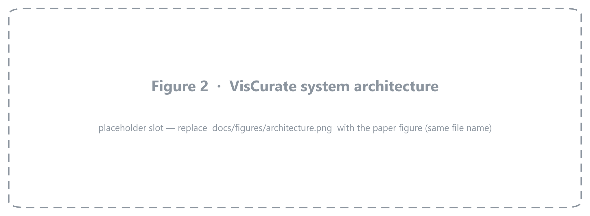
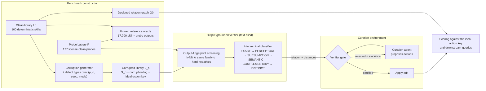
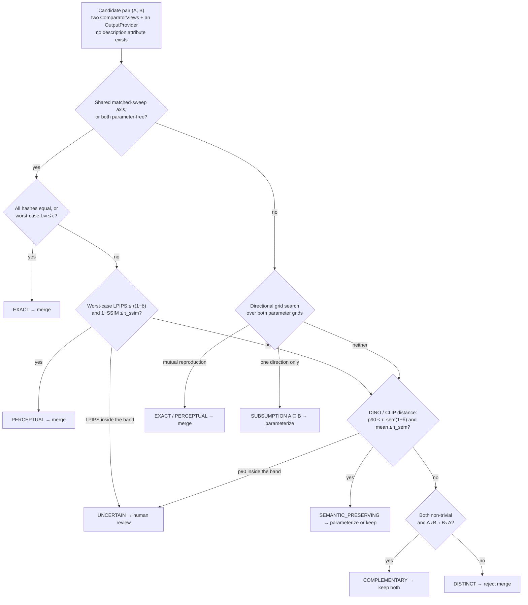
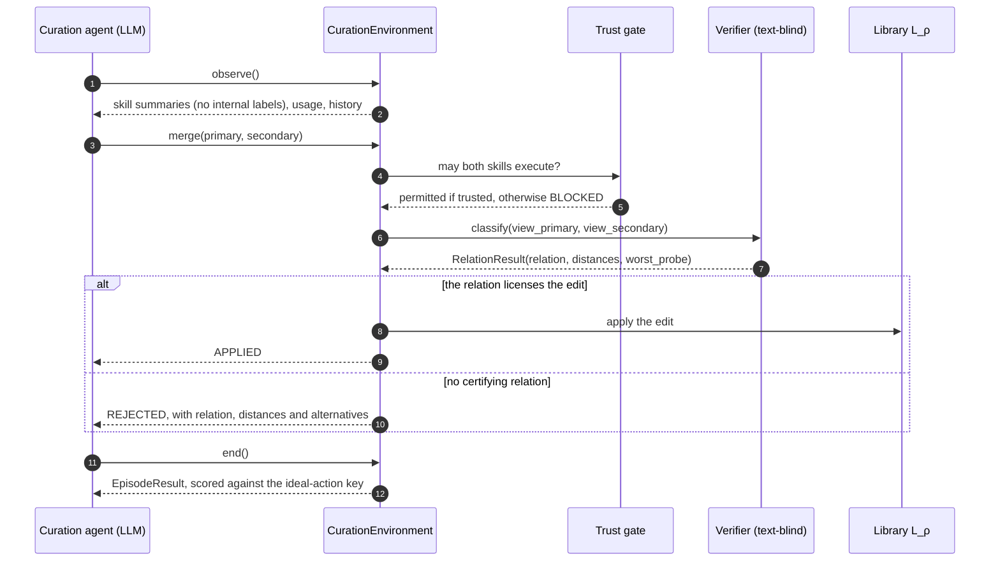
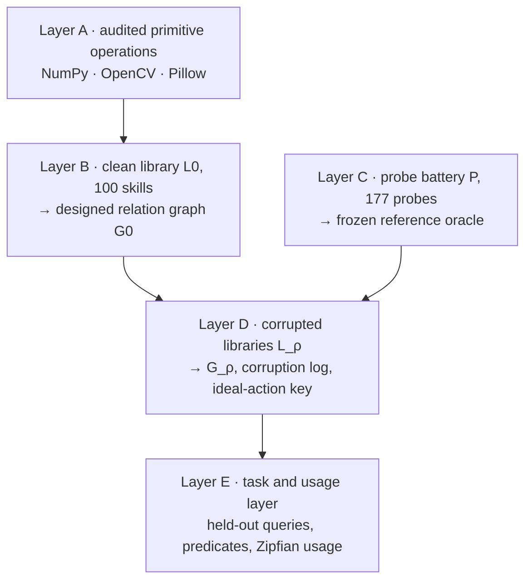

<div align="center">

# VisCurate

### Output-Grounded Equivalence Verification and Curation for Visual Skill Libraries

*Decide whether two image operators are the same by running them, not by reading their names and descriptions.*


[Abstract](#abstract) •
[Method](#2-method) •
[Benchmark](#3-benchmark-construction) •
[Results](#4-results) •
[Getting started](#6-getting-started) •
[Reproduce](#63-reproducing-the-experiments) •
[Documentation](#9-documentation-map) •
[Citation](#10-citation)

</div>

<p align="center">
  <picture>
    <source media="(prefers-color-scheme: dark)" srcset="docs/figures/teaser_dark.png">
    
  </picture>
</p>

> **Figure 1. Similar text does not mean the same behaviour.** `blur_gaussian_v1` and `blur_box_v1` have
> near-identical descriptions, and the repository's name-match baseline scores the pair exactly at its
> merge threshold (0.50 ≥ τ = 0.50). Running both skills over the matched kernel-size sweep tells a
> different story. The worst-case per-probe L∞ is 0.181 at *k* = 3 and 0.376 at *k* = 21, which is
> **46–96× the EXACT tolerance** ε = 1/255. *Left:* outputs and |Δ| maps on `syn_texture_010`, the
> worst-case probe at *k* = 21. *Right:* L∞ across 130 hash-verified synthetic probes of the 177-probe
> battery. The figure was produced by running this repository's code
> ([provenance](docs/figures/README.md)).

> [!TIP]
> **TL;DR.** VisCurate treats every skill as an executable image→image function. It decides the
> relation between two skills from their **outputs** on a license-clean probe battery, using a verifier
> that **cannot read descriptions**; the type system enforces this. Only EXACT or PERCEPTUAL verdicts
> can license a merge. Across **13,658** labelled pairs from **300** corrupted libraries, the verifier
> made **zero false merges** at a merge recall of **0.512**. On a real fork (`pilgram` → `pilgram2`)
> it found **23 of 25** shared filters byte-identical. Output-based candidate screening keeps the
> number of pairs to verify growing roughly linearly with library size (|C| ∝ n<sup>1.13</sup>),
> instead of quadratically.

---

## Abstract

Libraries of reusable visual *skills*, the image operators that agents and pipelines call, pick up
duplicates, near-duplicates, silent specializations and buggy variants as they grow. Curation decisions
are usually made from the text surface (names, descriptions, source code), yet similar text is neither
necessary nor sufficient for **behavioural equivalence**. **VisCurate** grounds equivalence in
observable behaviour instead. Skills are executed on a versioned, license-clean probe battery, and
their outputs are normalized under a versioned canonicalization contract. A hierarchical,
**text-blind verifier** then assigns each pair one of six relations: EXACT, PERCEPTUAL, SUBSUMPTION,
SEMANTIC-PRESERVING, COMPLEMENTARY or DISTINCT. A calibrated abstention band returns UNCERTAIN when a
distance falls too close to a threshold. The two relations that license a merge are certified by
worst-case aggregation over matched parameter sweeps. A curation agent can apply a structural edit
only when the verifier certifies it.

The benchmark contributions are a 100-skill clean library with a designed relation graph, a
replayable generator of corrupted libraries covering seven defect types, and an evaluation protocol
that reports exact intervals and instance-clustered uncertainty. Across 300 corrupted libraries, the
verifier makes **no false merges in 13,658 labelled pairs** (merge recall 0.512, 95% CI
[0.495, 0.530]). By contrast, the name-match and sentence-embedding baselines each merge **5 of 6**
engineered hard negatives. On real third-party code, **23 of 25** filters shared by a fork pair are
byte-identical. Of the 17 pairs that published cross-library mapping tables group as the same
operation, only **10** are certified mergeable at aligned parameters. Output-based screening keeps
verification cost near-linear in library size. A distributional extension based on
permutation-tested MMD handles stochastic neural operators (SAM 2.1, Depth Anything V2).

<details>
<summary><b>Table of contents</b></summary>

1. [Introduction](#1-introduction)
2. [Method](#2-method): [formulation](#21-problem-formulation) · [overview](#22-system-overview) · [canonicalization](#23-output-canonicalization) · [taxonomy](#24-a-six-relation-taxonomy) · [verifier](#25-hierarchical-text-blind-verification) · [calibration](#26-calibration-and-abstention) · [screening](#27-output-based-candidate-screening) · [gated curation](#28-verifier-gated-curation) · [trust boundary](#29-execution-trust-boundary) · [neural skills](#210-neural-and-stochastic-skills)
3. [Benchmark construction](#3-benchmark-construction)
4. [Results](#4-results)
5. [Limitations and open items](#5-limitations-and-open-items)
6. [Getting started](#6-getting-started)
7. [Repository structure](#7-repository-structure)
8. [Research integrity and reproducibility](#8-research-integrity-and-reproducibility)
9. [Documentation map](#9-documentation-map)
10. [Citation](#10-citation) · 11. [License](#11-license) · 12. [Acknowledgements](#12-acknowledgements)

</details>

---

## 1. Introduction

Agentic vision systems increasingly assemble behaviour from **skills**: small, reusable operators
such as *blur*, *resize* or *threshold*. Skill libraries grow by accretion: agent-authored additions,
forks, and independent re-implementations across libraries. Without curation they fill up with
redundant and subtly wrong entries. The cheap way to deduplicate is to compare what the skills *say*.
That is unsafe for two reasons:

- **Similar text is not enough to justify a merge.** `blur_gaussian` and `blur_box` both "convolve with a
  kernel". They agree closely at small kernel sizes and diverge at large ones (Figure 1).
- **Similar text is not required for a real duplicate either.** Two operators with unrelated names can
  compute the same function, and a text judge will never propose that merge.

The costly error is a **false merge**, because it silently deletes a capability that clients depend
on. VisCurate therefore makes *precision on non-equivalence* the primary objective and treats
library compression as secondary.

**Contributions.**

1. **A text-blind, output-grounded verifier.** It uses a six-relation taxonomy with an abstention class,
   worst-case aggregation over matched parameter sweeps, a directional subsumption search, and a
   commutation test for complementary operators. The modality boundary is enforced **by type**: the
   verifier receives a `ComparatorView` object, which has no `description` attribute.
2. **A verifier-gated curation environment.** It exposes an eight-action API. Structural edits
   (`merge`, `parameterize`, `split`) need a certifying relation from the verifier, and every rejection
   returns structured evidence: the relation, the deciding distances, and the alternatives still
   permitted.
3. **A controlled benchmark.** It comprises a clean 100-skill library `L0`, a designed relation graph
   `G0`, a 177-probe license-clean battery with a frozen reference oracle, and a replayable corruption
   generator covering 7 defect types. The generator produces 300 corrupted libraries.
4. **An empirical study across the full stack.** It covers an eight-rung text/code baseline ladder,
   self-validation on 300 corrupted libraries, two real uncurated libraries, nine LLM curation agents,
   probe ablations, out-of-distribution robustness, neural/stochastic operators, and a
   cost/scalability analysis.
5. **A research harness designed against fabricated results.** Execution is deterministic given the
   seed. Calibrated thresholds must carry provenance. Artifacts are manifest-backed, and report
   generators mark missing runs as *pending* instead of filling them in.

---

## 2. Method

### 2.1 Problem formulation

A **skill** is a function that is deterministic once its seed is fixed:

```math
f : \mathcal{X} \times \Theta_f \times \mathbb{N} \rightarrow \mathcal{X}, \qquad y = f(x;\, \theta,\, s)
```

Here *x* is an image, *θ* is a parameter binding validated against the skill's typed schema, and *s*
is the seed. Given a probe battery *P* and a canonicalization map *φ*, the verifier assigns every
ordered pair *(A, B)* exactly one relation:

```math
R(A,B) \in \{\mathsf{EXACT},\ \mathsf{PERCEPTUAL},\ \mathsf{SUBSUMPTION},\ \mathsf{SEMANTIC},\ \mathsf{COMPLEMENTARY},\ \mathsf{DISTINCT}\} \,\cup\, \{\mathsf{UNCERTAIN}\}
```

Here SEMANTIC is short for SEMANTIC_PRESERVING. Text judges and the output verifier can all be
compared on one binary decision, **mergeability**:

```math
\mathrm{merge}(A,B) \;=\; \mathbf{1}\big[\, R(A,B) \in \{\mathsf{EXACT},\ \mathsf{PERCEPTUAL}\} \,\big]
```

The verifier states **facts about outputs**. The curation agent makes **repository decisions**
(Section 2.8).

### 2.2 System overview

<p align="center">
  
</p>

> **Figure 2. System architecture.** Benchmark construction produces clean and corrupted libraries.
> The text-blind verifier certifies relations from executed outputs. The curation environment applies
> an agent's structural edit only when the verifier certifies it.
> *(Placeholder slot. Replace [`docs/figures/architecture.png`](docs/figures/README.md) with the
> paper figure; a text-rendered schematic follows.)*

<details>
<summary><b>Figure 2 (schematic):</b> end-to-end pipeline, rendered by GitHub from Mermaid source</summary>



</details>

### 2.3 Output canonicalization

Skills return heterogeneous outputs: grayscale images, RGBA, binary masks, edge maps and resized
canvases. Before any comparison, outputs pass through a versioned contract
(`skills/canonicalize.py`, `CANON_VERSION = 1.0.0`):

| Aspect | Rule |
|---|---|
| dtype and range | `float32 ∈ [0, 1]` for metrics; a `uint8` view is kept for hashing |
| channels | 1-channel outputs are replicated to 3; RGBA is composited over a fixed mid-grey with alpha tracked separately |
| shape | identical shape is a precondition for EXACT/PERCEPTUAL, so L∞ = ∞ on mismatch |
| binary masks | detected and compared by exact match and IoU, not by LPIPS |
| hashing | SHA-256 over the `uint8` view, shape, mask flag, alpha and contract version |

### 2.4 A six-relation taxonomy

**The six relations, the evidence that certifies each, and the action it licenses.** Only the first
two rows license a merge.

| Relation | Certified when (from outputs only) | Aggregation | Licensed action |
|---|---|---|---|
| **EXACT** | all canonical hashes are equal, or worst-case L∞ ≤ ε | max over sweep × probes | merge |
| **PERCEPTUAL** | worst-case LPIPS ≤ τ<sub>perc</sub>(1−δ) **and** worst-case (1−SSIM) ≤ τ<sub>ssim</sub> | max | merge |
| **SUBSUMPTION** (A ⊑ B) | every binding of A is reproduced by some binding of B, but not the reverse | ∀∃ grid search | parameterize (fold A into B) |
| **SEMANTIC_PRESERVING** | DINO (or CLIP) cosine distance with p90 ≤ τ<sub>sem</sub>(1−δ) and mean ≤ τ<sub>sem</sub> | p90 + mean | parameterize, or keep both (**never** merge) |
| **COMPLEMENTARY** | both skills change the image, and A∘B ≈ B∘A within tolerance | worst case | keep both |
| **DISTINCT** | none of the above (residual class) | — | keep separate |
| **UNCERTAIN** | the deciding distance falls inside the band [τ(1−δ), τ(1+δ)] | — | route to human review |

### 2.5 Hierarchical, text-blind verification

`equivalence/taxonomy.py::classify` checks relations from cheapest and strictest to most expensive,
and stops at the first relation that holds (Figure 3). The two relations that license a merge must
hold **on every probe**, so they use the worst case:

```math
d_m^{\max}(A,B) \;=\; \max_{(\theta_A,\theta_B)\,\in\,\mathcal{S}_{AB}} \;\; \max_{p\,\in\,P_{AB}} \;\; d_m\!\left(\phi\big(f_A(p;\theta_A,s)\big),\; \phi\big(f_B(p;\theta_B,s)\big)\right)
```

- *𝒮<sub>AB</sub>* is the matched sweep declared in `configs/param_alignment.yaml` (for example,
  `blur_gaussian` and `blur_box` over *k* ∈ {3, …, 21}). Without a declared sweep it is the pair of
  default bindings.
- *P<sub>AB</sub>* is the set of probes on which **both** skills produced an output.
- If *P<sub>AB</sub>* is empty, *d*<sup>max</sup> is set to +∞, so a pair with no comparable evidence
  can never be certified (Section 4.10).

SEMANTIC_PRESERVING describes a distribution of distances, so it tolerates a few outlier probes. It
also takes the more conservative of the two semantic backends:

```math
D_{AB} = \Big\{ \max\big(d_{\mathrm{DINO}}(p),\; d_{\mathrm{CLIP}}(p)\big) \Big\}_{p}, \qquad
\mathsf{SEM} \iff Q_{0.9}(D_{AB}) \le \tau_{\mathrm{sem}}(1-\delta) \;\wedge\; \overline{D_{AB}} \le \tau_{\mathrm{sem}}
```

**How parameters are handled.** A default binding is authoritative only when the two skills share a
declared matched-sweep axis, or when both have no parameters. Otherwise a directional grid search
decides:

```math
A \sqsubseteq B \iff \forall\, \theta_A \in \mathcal{G}_A \;\; \exists\, \theta_B \in \mathcal{G}_B :\; f_A(\cdot\,;\theta_A) \approx f_B(\cdot\,;\theta_B) \text{ on } P, \quad \text{and not } B \sqsubseteq A
```

Here ≈ means EXACT or PERCEPTUAL agreement. If each skill reproduces the other, the result is
EXACT/PERCEPTUAL rather than SUBSUMPTION. This rule is why `crop_center_percentage` is correctly
labelled a *special case* of `crop_bounding_box` rather than a duplicate.



> **Figure 3. The stop-at-first classifier.** Subsumption is checked *before* the semantic stage so
> that a loose semantic match cannot hide a directional special-case relation. Every verdict carries
> its deciding distances and the worst-case probe.

### 2.6 Calibration and abstention

Thresholds are **calibrated, never hand-tuned on test data.** Each τ is set to the most permissive
value that keeps **precision on non-equivalence ≥ 0.99**, subject to a recall floor of 0.5. The fit
uses a **cluster-disjoint split**: each operator family goes wholly into calibration or wholly into
test, and pairs that cross the split are dropped. The band half-width δ is the smallest value on a
grid that lifts precision on the pairs outside the band to target. `ThresholdConfig` rejects any
configuration marked `calibrated: true` that lacks a split hash and a date.

**Thresholds at the calibrated operating point, with their config keys.**

| Symbol | Config key | Value | Role |
|---|---|---|---|
| ε | `exact_epsilon` | 1/255 ≈ 0.0039 | rounding tolerance for EXACT |
| τ<sub>perc</sub> | `perceptual_lpips` | 0.05 | worst-case LPIPS bound |
| τ<sub>ssim</sub> | `perceptual_ssim` | 0.10 | 1−SSIM floor, which catches cases LPIPS misses |
| τ<sub>sem</sub> | `semantic_dino` | 0.15 | p90 semantic distance bound |
| q | `semantic_quantile` | 0.90 | aggregation quantile for the semantic stage |
| τ<sub>comm</sub> | `complementary_lpips` | 0.05 | commutation tolerance |
| δ | `abstention_delta` | 0.05 (calibrated run); 0.10 is the placeholder in `configs/default.yaml` | band half-width |

**Backbones.** The perceptual backbone is LPIPS (AlexNet). The semantic backbones are DINO ViT-B/16
(`vit_base_patch16_224.dino`) and CLIP ViT-B/32 (`ViT-B-32-quickgelu`, OpenAI weights). All three are
optional (`[ml]` extra), imported lazily, and loaded **one at a time** to fit a 6 GB GPU budget.

### 2.7 Output-based candidate screening

Verifying all O(n²) pairs is expensive. Filtering candidates by description similarity would
reintroduce the very bias under study. `equivalence/candidates.py` instead computes an **output
fingerprint** for each skill on a 12-probe screening sub-battery: average-hash bits plus a mean DINO
feature. For each skill it proposes the *k* nearest neighbours within fingerprint distance *r*. It
always adds every same-family pair and every engineered hard negative. Because fingerprints come from
outputs, two skills with unrelated descriptions but the same behaviour still end up as candidates.
The defaults are `k = 5` and `r = 0.5`; the scalability study in Section 4.9 shows that `k = 10`,
`r = 0.05` dominates them.

### 2.8 Verifier-gated curation

The agent sees a `CurationState`: skill summaries with the internal `is_buggy`/`is_dead` labels
removed, usage statistics, and the action history. It proposes one of eight actions (`add`,
`remove`, `modify`, `retrieve`, `merge`, `split`, `parameterize`, `end`) within a budget of 200
actions per episode. Structural actions go through `curation/gating.py`:

**Which structural edit each verifier relation permits (`curation/gating.py`).**

| Verifier relation | Structural edit permitted by the gate |
|---|---|
| EXACT · PERCEPTUAL | `merge` into one canonical skill |
| SUBSUMPTION (primary ⊑ secondary) | `parameterize`, folding the specialization into the generalizer (never the reverse) |
| SEMANTIC_PRESERVING | `parameterize` / unify, or keep both |
| COMPLEMENTARY · DISTINCT | none (keep separate) |
| UNCERTAIN | none (route to human review) |

The gate grants **permission**. Whether an edit is **desirable** is still the agent's decision: for
example, the environment flags folding away a skill that is heavily used. Each action ends in exactly
one of the outcomes `applied`, `rejected`, `blocked`, `noop` or `invalid`.



> **Figure 4. The curation loop.** Agents are pluggable: a scripted agent, any OpenAI-compatible
> endpoint (including a local vLLM server), Ollama, or the Anthropic API.

### 2.9 Execution trust boundary

- **Built-in skills** run in `SandboxedExecutor`: a fresh subprocess per call, a wall-clock timeout,
  POSIX `RLIMIT_AS`/`RLIMIT_CPU` limits (timeout only on Windows), and a hard `trusted` gate.
- **Agent-authored code** (from `add`, `split`, or a `modify` that replaces a function) is registered
  as `trusted=False`. It can run only through `HardenedExecutor`, and only if the environment sets
  `ExecutionPolicy(allow_untrusted=True, hardened=True)`. When bubblewrap is available,
  `HardenedExecutor` runs the code with no network, read-only mounts of the interpreter and `src/`, a
  per-run scratch directory, and single-threaded math libraries; otherwise it falls back to a plain
  subprocess. The shipped configuration keeps `allow_untrusted: false`.
- **Third-party packages** such as ComfyUI node packs are outside this boundary: importing a package
  already executes its code. Evaluating them requires a disposable VM
  ([findings §10](docs/reports/findings.md)).

### 2.10 Neural and stochastic skills

Operators such as SAM 2.1 or Depth Anything V2 have no shared seed space, so their outputs cannot be
compared point by point. For these, VisCurate replaces the point distance with a **per-probe
two-sample test** (`scripts/wacv_r2/run_a3_neural.py`). It computes the unbiased MMD² between
*K* = 16 stochastic draws of each skill, using a Gaussian kernel whose bandwidth is set by the median
heuristic:

```math
\widehat{\mathrm{MMD}}{}^2_u(p) \;=\; \frac{1}{K(K-1)}\sum_{i\neq j} k(a_i,a_j) \;+\; \frac{1}{K(K-1)}\sum_{i\neq j} k(b_i,b_j) \;-\; \frac{2}{K^2}\sum_{i,j} k(a_i,b_j), \qquad a_i \sim A(p),\; b_j \sim B(p)
```

**How the test is applied:**

- The null distribution comes from **2,000 within-probe permutations**.
- A probe rejects equivalence when *p* ≤ α/|P|, a Bonferroni correction with α = 0.05. One rejecting
  probe is enough to refute equivalence: the same worst-case rule as the deterministic path.
- Draws are **never pooled** across probes, because pooling loses the dependence on the input.
- Depth maps are affine-aligned by least squares before comparison.
- Every non-rejection is reported next to the skill's own **self-variance baseline**, because a
  non-rejection shows only a lack of evidence for a difference, not equivalence.

---

## 3. Benchmark construction

### 3.1 Five-layer design



> **Figure 5. Dataset construction.** The benchmark is a *family* of datasets indexed by
> (ρ, composition, seed, mode), not a single static file. Every label is fixed before any metric runs.

### 3.2 The clean library `L0`

**The 100 skills of `L0`, by family.**

| Family | # | Representative skills |
|---|---:|---|
| Geometric / canvas | 25 | flips; rotations (90°/180°/270°/45°/arbitrary); shear; scale; crops; nearest/bilinear/bicubic resize; pad (reflect/replicate/constant); tiling |
| Colour / exposure / contrast | 25 | BT.601/BT.709 grayscale; gamma; exposure stops; saturation; hue; posterize; quantize; levels; global and CLAHE equalization |
| Signal / blur / edges / morphology | 25 | Gaussian/box/median/bilateral/motion blur; unsharp mask; Sobel/Scharr/Prewitt/Laplacian/Canny edges; FFT filters; dilate/erode/open/close; non-local-means denoising |
| Masks / reconstruction / synthesis | 25 | Telea and Navier–Stokes inpainting; flood fill; contours; distance transform; Otsu/adaptive thresholding; k-means palette; dithering; halftone; mask→RGBA |

Every skill is `fn(image, params, seed) → image` with a typed parameter schema and a stable
`*_v1` id. `L0` is **defect-free**; defects are injected only by the corruption generator
(Section 3.5). Determinism classes are asserted in tests:

- 4 skills are *seeded-stochastic*: deterministic at a fixed seed and compared at matched seeds.
- 2 FFT filters are *precision-sensitive*: compared with PERCEPTUAL tolerance.
- The `cv2.kmeans` palette skill is *platform-sensitive*: compared only within one platform.

### 3.3 Probe battery and reference oracle

**Composition of the 177-probe battery.**

| Source | Domains | Probes | License |
|---|---|---:|---|
| Self-generated synthetics | texture 30 · gradient 25 · shape 25 · document 25 · noise 15 · colour chart 10 · degenerate 7 | 137 | CC0 1.0 |
| COCO test2017 | natural photographs | 40 | CC BY 2.0 (38) · no known copyright restrictions (2) |

- **Channel formats:** RGB 73 · RGBA 26 · grayscale 26 · 16-bit grayscale 26 · palette 26.
- **Degenerate cases:** all-black, all-white, single colour, 1×1, 1×N, N×1, and 1024² high-resolution.
- **Licensing:** the manifest rejects `license=unknown`; COCO photos under NoDerivs licenses are excluded.
- **Reference oracle:** all 100 × 177 = 17,700 outputs are frozen together with a determinism
  self-audit. The oracle confirms that injected defects took effect and scores the agents. It is
  **never** used to assign relation labels.

### 3.4 Designed relation graph `G0`

**The 24 designed relations of `G0` (`configs/ground_truth_g0.yaml`).**

| Relation | Pairs | Designed examples |
|---|---:|---|
| SUBSUMPTION | 7 | `rotate_{90,180,270,45}` ⊑ `rotate_canvas_degrees`; `crop_center_percentage` ⊑ `crop_bounding_box`; `linear_contrast_stretch` ⊑ `contrast_stretching_percentile`, `levels_adjust` |
| SEMANTIC_PRESERVING | 10 | BT.601 ↔ BT.709 grayscale; Sobel/Scharr/Prewitt/Canny/Laplacian edges; gamma ↔ exposure stops; global ↔ CLAHE equalization; Telea ↔ Navier–Stokes inpainting; Otsu ↔ adaptive-mean thresholding |
| COMPLEMENTARY | 1 | dilate ↔ erode |
| DISTINCT (engineered hard negatives) | 6 | Gaussian ↔ box blur; nearest/bilinear/bicubic resize (3 pairs); reflect ↔ replicate padding; posterize ↔ uniform quantize |
| EXACT / PERCEPTUAL | 0 | empty in `L0` by design; duplicates are injected by the corruption generator |

- Every pair not listed defaults to DISTINCT. The equivalence benchmark scores **944** candidate
  pairs, of which **926** are DISTINCT.
- The key is validated structurally: subsumption must form a DAG, EXACT must be transitive, and
  PERCEPTUAL/SEMANTIC relations are symmetric but **not** assumed transitive.
- A separate key, `ground_truth_g0_hardneg69.yaml`, expands the hard-negative slice to **69** pairs.
  The added pairs were chosen from operator definitions alone, never from verifier output.

### 3.5 Corruption generator

**The seven defect types, their effect on the verifier, and the repair each one calls for.**

| # | Defect | Mechanism | Visible to the verifier? | Change to `G_ρ` | Ideal repair |
|---:|---|---|---|---|---|
| 1 | Implementation bug | mutate `fn` (e.g. off-by-one kernel, wrong axis, sign swap) | yes (differs from the oracle) | — | `remove` |
| 2 | Metadata mislead | rewrite the name and description; outputs unchanged | **no** | — | `modify` |
| 3 | Duplicate | clone as EXACT or PERCEPTUAL under a new id | yes | EXACT / PERCEPTUAL | `merge` |
| 4 | Subsumption | add a baked-in specialization | yes (directional) | SUBSUMPTION | `parameterize` |
| 5 | Parameter-schema bug | corrupt a default value; `fn` unchanged | partial | — | `modify` |
| 6 | Domain-scoped bug | correct on RGB, broken on RGBA or grayscale | only if the battery covers that domain | — | `modify` |
| 7 | Dead skill | add a correct skill that no query needs | **no** (a usage question) | — | `remove` |

Types 2 and 7 are invisible to output comparison **by design**. They are the reason the verifier and
the agent are separate roles.

The generator is replayable. Each defect is produced by a **named mutator factory**, and the
**corruption log is the canonical artifact**: `L_ρ` is a pure function of `(L0, log)`, so no skill is
ever pickled. Defect counts per type are apportioned by the Hamilton method, with an honest record
when eligible skills run out. Per-type QA assertions check that defects are active (types 1 and 6
must change outputs) and that types 2 and 5 leave outputs unchanged.

```
ρ ∈ {0.1, 0.2, …, 1.0}  ×  {uniform, duplicate_heavy, metadata_heavy}  ×  5 seeds  ×  {single, mixed}  =  300 libraries
```

### 3.6 Real-world corpora

- **Fork pair.** `pilgram` 2.0.0 and `pilgram2` 2.0.10 form a real fork: 25 shared filters, 14 added
  by the fork, and no tooling in either library that detects the overlap.
- **Corpus A: cross-library functional cores.** 93 implementations across 20 operation families,
  drawn from OpenCV, Pillow, SciPy, scikit-image, torchvision, Albumentations and Kornia, give 182
  within-family pairs. The pair list comes from published Albumentations↔torchvision and
  Albumentations↔Kornia mapping tables. Parameter alignments were written from documentation and
  frozen before anything was executed.
- **Corpus B: ComfyUI node packs.** Specified in full, but **blocked**: executing untrusted packs
  requires disposable-VM containment (Section 5).

---

## 4. Results

All numbers in this section are transcribed from the round-2 findings report,
[`docs/reports/findings.md`](docs/reports/findings.md) (compiled August 2026). The raw artifacts live
in `results/wacv_r2/`, which is git-ignored and regenerated from manifests. Rates are reported with
raw counts and exact 95% intervals. Uncertainty is clustered by corruption instance, never by pair.
Thresholds are the Phase-4 calibrated operating point and were **never re-fit** on evaluation data.

### 4.1 Experimental protocol

**Setup shared by all experiments.**

| Component | Setting |
|---|---|
| Library / pairs | `L0` (100 skills); 944 scored `G0` pairs; 300 `G_ρ` libraries |
| Probe battery | 177 probes (137 CC0 synthetics and 40 COCO photographs) |
| Backends | LPIPS-AlexNet with SSIM floor; DINO ViT-B/16; CLIP ViT-B/32 (conservative max) |
| Calibration | 713 cluster-disjoint pairs from 8 families; 100 held-out test pairs from disjoint families |
| Seed | 1234 |

### 4.2 Text and code baselines

Eight judges ("rungs") were evaluated on the same 944-pair `G0` benchmark at fixed operating points
([findings §2](docs/reports/findings.md)):

**The baseline ladder on `G0` (944 pairs).** A false merge is a merge of a pair whose true relation
does not license one.

| Rung | Judge | Reads | Operating point | False-discovery rate on merges ↓ | False-merge rate on DISTINCT pairs ↓ | False merges on hard negatives ↓ | Abstentions |
|---:|---|---|---|:---:|:---:|:---:|:---:|
| 1 | name match | name, id | τ = 0.50 | 1.0000 | 0.0540 | **5/6** [0.359, 0.996] | 0 |
| 2 | TF-IDF cosine | description | τ = 0.60 | 1.0000 | 0.0021 | 0/6 [0.000, 0.459] | 0 |
| 3 | sentence embedding | description | τ = 0.60 | 1.0000 | 0.0561 | **5/6** [0.359, 0.996] | 0 |
| 4 | code embedding | source (docstrings stripped) | τ = 0.90 | 1.0000 | 0.0180 | **4/6** [0.223, 0.957] | 0 |
| 5a | AST clone, structure only | source | τ = 0.90 | — | 0.0000 | 0/6 | 0 |
| 5b | AST clone, semantics-preserving | source | τ = 0.90 | — | 0.0000 | 0/6 | 0 |
| 6 | LLM on descriptions | description | categorical | 1.0000 | 0.0011 | 1/6 [0.004, 0.641] | 0 |
| 7 | LLM on source | source | 120/944 pairs × 3 repeats | — | — | mean 0 | 0 |
| **8** | **output-grounded (ours)** | **outputs only** | categorical | — | **0.0000** | **0/6** [0.000, 0.459] | 14 (1.5%) |

**How to read this table:**

- The name-match and sentence-embedding judges each merge 5 of the 6 engineered hard negatives; the
  output-grounded verifier merges none.
- The LLM result depends on the judge model: a rerun with gpt-5.4 produced 0/926 and 0/6. The
  strongest claim is therefore about the *taxonomy*, not about any single safety number.
- `G0` has no mergeable positives, so precision-recall curves are undefined there and the table
  reports operating points only. Scoring the ladder against oracle labels (to obtain AUPRC) is listed
  in Section 5.

### 4.3 Verifier self-validation

`G_ρ` injects true duplicates, which makes it the only setting where **merge recall** can be measured
([findings §1](docs/reports/findings.md)). The answer key was first repaired for incidental relations
created by cloning:

- Relations inherited from EXACT clones were added to the key.
- Relations inherited from PERCEPTUAL clones were **excluded rather than guessed**.

**Merge decisions on all 300 corrupted libraries.**

| Quantity | n = 300 instances |
|---|---|
| Pairs scored / errors | **13,658** / 0 (14 out-of-memory rows re-run and repaired) |
| Mergeable support (EXACT ∪ PERCEPTUAL) | 3,310 |
| **Merge recall** | **0.5124** [0.4952, 0.5295]; instance-clustered bootstrap [0.4965, 0.5284] |
| Precision · F1 | 1.0000 · 0.6776 |
| **False-discovery rate on merges** | **0.0000** |
| TP / FP / FN / TN | 1,696 / **0** / 1,614 / 10,348 |

<details>
<summary><b>Per-relation breakdown</b> (n = 300)</summary>

| Relation | Support | Recall [95% CI] | Precision |
|---|---:|---|---:|
| EXACT | 1,640 | **0.9683** [0.959, 0.976] | 1.0000 |
| PERCEPTUAL | 1,667 | 0.0438 [0.034, 0.055] | 0.6952 |
| SUBSUMPTION | 4,672 | 0.7581 | 0.9961 |
| SEMANTIC_PRESERVING | 3,424 | 0.3186 | 0.2784 |
| COMPLEMENTARY | 310 | 0.0000 | 0.0000 |
| DISTINCT | 1,942 | 0.3836 | 0.1880 |

</details>

**What these numbers show:**

- **There are zero false merges at all ten corruption rates.** Merge safety does not degrade as the
  library gets dirtier, and a cross-shard determinism check found 0 verdict disagreements.
- **Almost all missed consolidation comes from one confusion.** 1,592 PERCEPTUAL pairs are labelled
  SEMANTIC_PRESERVING: the semantics match but the pixels differ, and the verdict lands one step
  short of licensing a merge. This single confusion accounts for **≈ 98.8%** of missed merges. Exact
  duplicates are found 96.8% of the time.
- **UNCERTAIN is rare but real.** It was emitted 2 times in 13,658 pairs.

### 4.4 Hard-negative safety bound

**False merges on the engineered hard-negative slices.**

| Slice | False merges | Exact 95% CI | One-sided 95% upper bound |
|---|:---:|:---:|:---:|
| Original 6 designed pairs | 0/6 | [0.000, 0.459] | 0.393 |
| **Expanded 69 pairs** | **0/69** | **[0.0000, 0.0521]** | **0.0425** |

The expanded slice supports a bound of at most 5%, with one condition. The verifier gives 26 of the
69 pairs a relation that does not license a merge but is also not DISTINCT. If human adjudicators side
with the verifier on those pairs, the slice shrinks to 43 pairs and the upper bound rises to 6.7%. A
blinded adjudication package for three annotators has been prepared (Section 5). This also dictates
the wording: the supported claim is "*never licenses a false merge*", **not** "*keeps hard negatives
DISTINCT*", because 5 of the 6 original pairs are labelled SEMANTIC_PRESERVING rather than DISTINCT.

### 4.5 Real uncurated libraries

**Results on the two real corpora.**

| Corpus | Self-pair sanity check (each skill vs. itself) | Headline result |
|---|:---:|---|
| **Fork pair** (`pilgram` vs `pilgram2`) | 50/50 [0.929, 1.000] | **23/25 shared filters are EXACT**: byte-identical on all 177 probes and licensed to merge. The other 2 are SEMANTIC_PRESERVING and correctly **not** merged. |
| **Corpus A** (182 cross-library pairs) | 93/93 [0.961, 1.000] | Of 17 pairs that published tables group as the same operation, **10 survive execution** (0.588 [0.329, 0.816]); restricted to fully aligned pairs, 10/14 (0.714 [0.419, 0.916]). |

- **92% of a real fork's shared surface is exactly redundant, and nothing in either library notices.**
  Independent re-implementations, in contrast, diverge.
- **A real-world example of the taxonomy at work.** The `perpetua` filter has **LPIPS 0.2464**
  (visibly different) but **DINO p90 0.0008** (semantically indistinguishable). A perceptual-only gate
  would call it divergent, and a semantic-only gate would merge it.
- **Corpus A has no human ground truth, so a differential oracle supplies one** (`build_oracle.py`).
  It labelled all 182 pairs (75 EQUIVALENT, 107 DISTINCT, 0 AMBIGUOUS), with tolerances derived from
  the pixel representation rather than tuned toward agreement. Against the text and code judges it is
  independent ground truth. Against the verifier it is only an *approximation-versus-exhaustive*
  check, because both execute the same code.

### 4.6 LLM curation agents

Each model acted as the curation agent on the 300 corrupted libraries (one run covers only 41 of
them; see †). Its action logs were scored against the ideal-action key
([findings §6](docs/reports/findings.md)). Per the findings report, these episodes were gated with the
ML-free verifier path (`--no-ml`).

<p align="center">
  <picture>
    <source media="(prefers-color-scheme: dark)" srcset="docs/figures/curators_dark.png">
    
  </picture>
</p>

> **Figure 6. Curation quality by model.** Mean action-level F1 with instance-clustered 95% CIs. The
> hollow marker (gpt-5.6-luna) covers only the 41 highest-ρ instances and is not comparable with the
> full-grid rows.

**Action-level curation quality per model.** Intrinsic score = action quality after penalties for
missed repairs and for rejected, blocked or invalid actions.

| Model | n | Mean F1 [95% CI] | Precision | Recall | Intrinsic score | Mean action cost |
|---|---:|---|---:|---:|---:|---:|
| gpt-5.6-luna † | 41 | 0.6201 [0.5946, 0.6471] | 0.8001 | 0.5165 | 0.5061 | 148.68 |
| **gpt-5.5** | 300 | **0.5868** [0.5719, 0.6012] | 0.7346 | 0.5305 | 0.4959 | 78.86 |
| qwen3.5-27b | 300 | 0.5050 [0.4903, 0.5206] | 0.6621 | 0.4233 | 0.3577 | 109.59 |
| gemma4-12b | 300 | 0.2900 [0.2754, 0.3059] | 0.7768 | 0.2036 | 0.1588 | 172.23 |
| qwen3.5-4b | 300 | 0.1090 [0.0967, 0.1222] | 0.2899 | 0.0977 | 0.0626 | 185.37 |
| qwen3.5-9b | 300 | 0.1010 [0.0848, 0.1174] | 0.3572 | 0.0739 | 0.0601 | 171.52 |
| llama3.1-8b | 300 | 0.0948 [0.0847, 0.1060] | 0.6150 | 0.0609 | 0.0491 | 200.00 |
| llama3.2-3b | 300 | 0.0237 [0.0194, 0.0284] | 0.4433 | 0.0127 | 0.0119 | 200.00 |
| qwen3.5-2b | 300 | 0.0130 [0.0086, 0.0182] | 0.1338 | 0.0077 | 0.0070 | 128.35 |
| llama3.2-1b | 300 | 0.0000 [0.0000, 0.0000] | 0.0000 | 0.0000 | 0.0000 | 152.11 |

<sub>† Covers only the 41 highest-ρ instances; not poolable with the n = 300 rows. The action budget is 200, so a mean cost of 200 means the model always exhausted its budget.</sub>

- **Even the best model completes only about half of the required repairs:** gpt-5.5 has recall 0.531.
- **Higher corruption rates are not uniformly harder, and the direction depends on the model.**
  gpt-5.5's F1 *rises* from 0.421 at ρ = 0.1 to 0.630 at ρ = 0.9, qwen3.5-27b stays flat, and
  gemma4-12b and qwen3.5-4b fall by about 0.18.
- **Small models barely act correctly:** every model at 9B parameters or below stays under F1 = 0.11.

### 4.7 Neural and stochastic operators

The distributional test from Section 2.10 was run on six neural skills: SAM 2.1 (large and small),
Depth Anything V2 (large and small), and two purpose-built negatives. Each skill was sampled 16 times
on each of 40 probes, with 2,000 permutations per test and α = 0.05
([findings §9.1](docs/reports/findings.md)).

**Sanity checks.** Both pass:

- **6/6** self-pairs were *not* distinguishable (the noise floor).
- **2/2** hard negatives were distinguishable (95% CI [0.158, 1.000]).

**Pairwise comparisons.** "Probe domain" is either the full battery or only the probes where the task
applies (images that contain objects).

| Comparison | Probe domain | Verdict | Min *p* | Probes rejecting equivalence |
|---|---|---|---:|---:|
| DAv2-Large vs DAv2-Small | full | DISTINGUISHABLE | 0.0005 | 40/40 |
| SAM2-Large vs SAM2-Small | full | DISTINGUISHABLE | 0.0005 | 13/38 |
| SAM2-Large vs SAM2-Small | applicable | not distinguishable | 0.0355 | 0/10 |
| depth vs disparity (hard negative) | full | DISTINGUISHABLE | 0.0005 | 38/40 |
| instance vs semantic masks (hard negative) | applicable | DISTINGUISHABLE | 0.0010 | 3/10 |

**Finding.** The two SAM 2.1 capacities can be told apart on synthetic patterns but **not** on
images that contain objects, which is where segmentation is actually defined. This is reported
against the self-variance baseline and is not a claim of equivalence. The experiment also exposed a
limit of the battery: only 40 of its 177 probes are photographs, so it is not a valid domain for
segmentation skills.

### 4.8 Robustness: probe diversity and out-of-distribution inputs

**Probe ablation** ([findings §9.2](docs/reports/findings.md)). Nested batteries with |B| from 8 to 177
probes were tested on the 24 designed `G0` pairs, using three probe-selection strategies.

- **Accuracy does not change with battery size:** all confidence intervals overlap.
- **Safety does change, and it depends on diversity rather than count:**

**False merges on the 6 hard negatives, by battery size and probe-selection strategy.**

| Probe selection | \|B\| = 8 | 16 | 32 | 64 | 128 | 177 |
|---|:---:|:---:|:---:|:---:|:---:|:---:|
| stratified across classes | 0 | 0 | 0 | 0 | 0 | 0 |
| random | 0 | 0 | 0 | 0 | 0 | 0 |
| first N (all from one class) | **1** | **1** | **1** | **1** | 0 | 0 |

**Recommendation: never select probes by index; stratify them across classes.** Using the pixel
backend alone gives accuracy close to the full stack (0.46 vs 0.50), with 0/6 false merges in every
configuration.

**Out-of-distribution certificate flips** ([findings §9.3](docs/reports/findings.md)). A new battery,
B<sub>ood</sub>, has 31 probes from 6 classes absent from the original battery: extreme aspect
ratios, HDR, medical, satellite, saturated and tiny images. The question is whether merges the
verifier certified on real third-party libraries still hold on it. Thresholds were not re-calibrated.

| Certified merges re-tested | Certificates that flipped | Flip rate [95% CI] | One-sided upper bound |
|:---:|:---:|:---:|:---:|
| 74 | 1 (`alb.gaussian_blur` vs `cv2.GaussianBlur`: PERCEPTUAL → SEMANTIC_PRESERVING) | **0.0135** [0.0003, 0.0730] | 0.0625 |

**The objection that a finite battery cannot guarantee behaviour on unseen inputs is valid, but the
effect is bounded:** about 1.4% of merges flipped on this corpus, with an upper bound of 6.3%.

### 4.9 Scalability and cost

Findings §5 analyses 262,833 telemetry events.

<p align="center">
  <picture>
    <source media="(prefers-color-scheme: dark)" srcset="docs/figures/scalability_dark.png">
    
  </picture>
</p>

> **Figure 7. Screening is safe and near-linear.** **(a)** The shipped setting (k = 5, r = 0.5) is
> dominated: *k* is what limits recall, not the radius. With k = 10 and r = 0.05, the screen keeps
> every mergeable pair (recall 1.000) and still removes 95.07% of pairs. **(b)** On nested subsamples,
> the candidate set grows as |C| = 2.379·n<sup>1.126</sup> (R² = 0.998), compared with n(n−1)/2 for
> exhaustive pairing. The fit covers n ≤ 100; a projection to n = 10⁴ would give about 660× fewer
> pairs, but that value is extrapolated.

**Where the cost goes, measured from telemetry.**

| Measurement | Value |
|---|---|
| Pairs decided before any learned backend runs | **54.9%** |
| Deciding stage | residual 47.2% · semantic 21.0% · subsumption 15.9% · complementary 7.4% · exact 7.2% · perceptual 0.9% · abstention band 0.4% |
| Signature cache hit rate | 78.2% (184,824 / 236,305) |
| Pair verification time | median 401 ms · p95 64.5 s |
| Output cache per skill (177 probes) | 214.8 MB, which extrapolates to **2.1 TB** at 10⁴ skills |
| Features-only cache (analytic estimate) | 5.4 GB at 10⁴ skills, about **395× smaller** |
| Tokens per *correct* repair | gpt-5.5: **9,202** · gpt-5.6-luna: **10,667** (same 41 instrumented episodes) |

Cost per repair divides total tokens by *correct repairs*, not by the number of actions applied. For
`llama3.2-1b` this cost is **undefined**, because the model made zero correct repairs.

### 4.10 Defects found by the evaluation

The evaluation surfaced two bugs in the verifier code, both fixed:

1. **Merge certified with no evidence (safety-critical).** The perceptual sweep seeded its running
   maximum at −1, which is below every threshold. As a result, a pair with **no probe on which both
   skills ran** was certified PERCEPTUAL and licensed to merge. A skill that fails on every probe,
   such as corruption type 7 or a third-party function that cannot run on the battery, hit exactly
   this path. The Corpus-A self-pair check exposed the bug. The fix adds the empty-evidence guard
   that the pixel stage already had, so such pairs now get +∞ and fall through to DISTINCT. A
   completeness audit shows this was the only unguarded path to a merge-licensing verdict.
   Regression tests are in `tests/test_taxonomy_empty_common.py`.
2. **Hard-negative list out of sync with the answer key.** The list in `candidates.py` had lost one
   pair from the answer key. The pair was restored, and `configs/ground_truth_g0.yaml` was declared
   authoritative.

### 4.11 Summary

| Question | Answer |
|---|---|
| Is output grounding safer than text? | **Yes.** No false merges where the name-match and sentence-embedding judges merge 5 of 6 hard negatives (§4.2, §4.4). |
| What does that safety cost? | About half of the mergeable pairs; almost all misses are PERCEPTUAL pairs labelled SEMANTIC_PRESERVING, i.e. a threshold-placement issue (§4.3). |
| Does it hold on real code? | Yes. 23/25 fork filters are certified EXACT, and 7 of 17 published same-operation pairs are not certified mergeable (§4.5). |
| Does it scale? | Candidate growth is n<sup>1.13</sup>, and 55% of pairs are decided before any learned backend runs (§4.9). |
| Does it extend beyond deterministic operators? | Yes, as a feasibility result: 6/6 self-pair checks and 2/2 hard negatives pass for SAM 2.1 and DAv2 (§4.7). |

---

## 5. Limitations and open items

The findings report keeps *pending*, *blocked* and *deliberately not done* as separate categories.
The same distinction is kept here.

| Item | Status | Detail |
|---|---|---|
| Adjudication of the 26 non-DISTINCT hard negatives | **pending (human)** | Decides whether the hard-negative bound is 4.25% or 6.7%. A blinded package for three annotators exists; Fleiss κ and the CANNOT-TELL rate are not yet available. |
| Independent review of the merge-gate fix (§4.10) | **pending (human)** | The completeness audit was a self-review. |
| Baseline ladder scored against oracle labels (AUPRC) | pending (code) | `build_units()` does not yet know the Corpus-A skill ids. |
| Corpus B (ComfyUI) | **blocked** | Requires disposable-VM containment (no network, read-only filesystem, no credentials). |
| PERCEPTUAL recall (0.044) and the COMPLEMENTARY detector (0 recall on 310 positives) | open methods work | The commutation test is necessary but not sufficient. |
| Downstream task-success studies (Phases 7–8) | machinery built | Query stream, solvers, Pareto and ablation code exist; no downstream results are reported yet. |
| Cost data for self-hosted models | not measured | Telemetry was added after the vLLM runs, and backfilling it was deliberately not done. |
| Dependence on the vision backbones | inherent | Verdicts inherit the biases of LPIPS, DINO and CLIP; taking the max over DINO and CLIP mitigates this but does not remove it. |
| Platform notes | known | Windows executors enforce only the timeout (no resource limits); `RLIMIT_AS` behaves differently on macOS. `angular_gradient` probes are float-sensitive across platforms ([figures notes](docs/figures/README.md)). |

---

## 6. Getting started

### 6.1 Installation

VisCurate requires **Python ≥ 3.11**. The core harness (skills, probes, corruption, curation) needs no
machine-learning dependencies.

```bash
git clone https://github.com/farhanishraq17/VisCurate-.git
cd VisCurate-
python -m venv .venv && source .venv/bin/activate     # Windows: .venv\Scripts\activate

pip install -e ".[dev]"          # core harness + ruff / mypy / pytest
pip install -e ".[dev,ml]"       # + LPIPS / DINO / CLIP comparators
pip install -e ".[viz,agent]"    # optional: matplotlib figures, Anthropic client
```

**Installing the `[ml]` extra.** Install a *matched* `torch`/`torchvision` pair first. On CPU-only
machines, use `pip install torch torchvision --index-url https://download.pytorch.org/whl/cpu`. This
prevents a mismatched CUDA build of `torchvision` from being pulled in.

**Exact pins.** `requirements.txt` pins the development environment. Install it with
`pip install -r requirements.txt && pip install -e . --no-deps`.

**Extra packages for the round-2 scripts:**

- `sentence-transformers` and `transformers` for baseline rungs 3 and 4.
- `albumentations`, `kornia`, `scikit-image` and `scipy` for Corpus A.
- The pinned fork-pair corpus: run `pip install --target .corpusb_libs pilgram==2.0.0 pilgram2==2.0.10 imgaug==0.4.0`,
  then add `.corpusb_libs` to `PYTHONPATH`.

Credentials (`OPENAI_API_KEY`, `ANTHROPIC_API_KEY`) are read from the environment or from a local
`.env` file. `.env` is git-ignored.

### 6.2 Quick start

```bash
viscurate skills                                   # list the 100 built-in skills
viscurate config -c configs/default.yaml           # validate a configuration

# Offline smoke battery (synthetic probes only, no downloads) and its frozen oracle
viscurate build-probes -c configs/probes_smoke.yaml -o data/probe_images
viscurate freeze-oracle --probes-dir data/probe_images -o data/oracle/oracle.json

# Smoke benchmark: the 24 designed G0 pairs, ML-free verifier, LLM judge skipped
viscurate run-benchmark --no-ml --llm-model "" -o results/phase4_smoke
```

The benchmark run writes `report.md`, `pairs.csv`, `divergence.csv`, `text_operating_points.csv`,
`manifest.json` and a human-review template; it also writes `divergence.png` if `[viz]` is installed.
A skipped text track is recorded as *not run*; it is never filled with a stub result.

### 6.3 Reproducing the experiments

The main pipeline, in dependency order:

```bash
# 0 · The full 177-probe battery (downloads 40 license-filtered COCO photos) and its oracle.
#     Rebuilding in place lets `git diff` check the result against the committed manifest.
P=data/probe_images_full
viscurate build-probes -c configs/probes.yaml -o $P
git diff --stat -- $P/manifest.json
viscurate freeze-oracle --probes-dir $P -o data/oracle/oracle.json

# 1 · Equivalence benchmark (real backends) with calibration on the cluster-disjoint split
viscurate run-benchmark --probes-dir $P --device cuda --clip --calibrate --date 2026-08-01 \
    -o results/phase4_benchmark

# 2 · The 300 corrupted libraries: L_ρ, G_ρ, corruption logs, ideal-action keys, per-type QA
viscurate corrupt -c configs/corruption.yaml --probes-dir $P -o data/corruption

# 3 · Verifier-gated curation (example: a local vLLM model through its OpenAI-compatible API)
viscurate curate --instance data/corruption/<instance> --probes-dir $P \
    -c results/phase4_benchmark/calibrated_thresholds.yaml \
    --openai-model Qwen/Qwen3.5-4B --openai-base-url http://localhost:8001/v1 \
    -o results/phase6/<model>/<instance>

# 4 · Downstream queries, study aggregation, and the manifest-backed paper bundle
viscurate build-queries -c configs/queries.yaml --probes-dir $P -o data/queries
viscurate run-downstream --queries-dir data/queries --solver expected -o results/phase7_downstream
viscurate phase8 --points <study_points.json> -o results/phase8_studies --ci-method bootstrap
viscurate phase9 -c configs/phase9.yaml -o results/phase9
```

**Notes on the pipeline:**

- `--date` stamps the calibration provenance; use the date of your run.
- The default LLM judge in `run-benchmark` calls an OpenAI-compatible endpoint (`--llm-model`).
  Pass `--llm-anthropic` to use Claude instead.
- The WACV round-2 analyses live in [`scripts/wacv_r2/`](scripts/wacv_r2/). Each script explains its
  design constraints in its module docstring, and the `run_*`/`score_*`/`build_*` runners list their
  options with `--help`.
- Before running them, `source vc_env.sh`, which sets the telemetry path and loads credentials.
- The operational order and the go/no-go checks are in
  [`docs/wacv_r2/RUNBOOK.md`](docs/wacv_r2/RUNBOOK.md).

<details>
<summary><b>Round-2 scripts</b> (<code>scripts/wacv_r2/</code>)</summary>

| Experiment | Scripts |
|---|---|
| A1 · real libraries (Corpus A, fork pair) | `scrape_corpus_a.py`, `corpus_a_lib.py`, `gen_fork_pair_alignment.py`, `run_corpus_a.py`, `build_oracle.py`, frozen `corpus_a_*.yaml` maps |
| A2 · baseline ladder | `run_a2_ladder.py` |
| A2 · verifier self-validation on `G_ρ` | `run_grho_replay.py`, `merge_grho_replay.py` |
| A2 · hard negatives and adjudication | `score_hardnegatives.py`, `merge_hardneg_shards.py`, `build_adjudication_package.py`, `score_adjudication.py` |
| A2 · robustness | `run_probe_ablation.py` (T5), `run_ood.py` (T6) |
| A3 · neural and stochastic skills | `run_a3_neural.py` (T7) |
| A4 · cost and scalability | `a4_candidate_sweep.py`, `a4_full.py`, `analyze_telemetry.py` |
| Table 1 aggregation | `aggregate_curation.py` (instance-clustered bootstrap from raw episodes) |

</details>

<details>
<summary><b>Cluster drivers</b> (repository root)</summary>

These were written for a SLURM/GPU cluster. Every path is an environment-variable override
(`PYTHON_BIN`, `MODEL`, `PORT`, `CONFIG`, `OUT_ROOT`, …). Each script `cd`s to the repository root, so
the scripts must stay there.

| Script | Purpose |
|---|---|
| `start_vlm.sh` | serve a model with vLLM, sizing GPU memory automatically |
| `run.sh` | single-instance smoke test: start vLLM, run `viscurate curate`, stop the server |
| `smoke_vllm_models.sh` | per model: start vLLM, send one chat request, run one curation action |
| `run_vllm_curation_sweep.sh` | run one vLLM-served model over every corruption instance |
| `run_vllm_model_queue.sh` · `run_vllm_small_model_queue.sh` | queue several models through the sweep |
| `run_openai_curation_sweep.sh` | the same sweep with a hosted OpenAI-compatible model |
| `phase4_run.sh` | equivalence benchmark with LPIPS/DINO/CLIP and calibration (Claude as the LLM judge) |
| `phase6_run.sh` · `phase6_parallel.sh` | curation sweep with real visual gating, spread over workers that share one vLLM server |
| `mem_sampler.sh` | sample host RSS and GPU memory of a running benchmark |
| `vc_env.sh` | environment for the round-2 runs (interpreter, telemetry file, credentials) |

</details>

### 6.4 Command-line reference

**Subcommands of the `viscurate` CLI.**

| Command | Phase | Purpose |
|---|:---:|---|
| `viscurate config` | 0 | load and validate a YAML configuration |
| `viscurate skills [--json]` | 1 | list the built-in skill library |
| `viscurate build-probes` | 2 | build the probe battery and its manifest |
| `viscurate freeze-oracle` · `freeze-sweep-oracle` | 2 | freeze reference outputs at default or aligned bindings |
| `viscurate run-benchmark` | 4 | verifier and text judges → divergence report, per-pair table, calibrated thresholds |
| `viscurate corrupt` | 5 | generate the `(ρ, c, seed, mode)` family of corrupted libraries |
| `viscurate curate` | 6 | run an agent (scripted, OpenAI-compatible/vLLM, Ollama, Anthropic) with verifier gating |
| `viscurate build-queries` · `run-downstream` | 7 | held-out query stream and downstream solver scoring |
| `viscurate phase8` | 8 | study aggregation: CIs, Pareto fronts, construct validity, vision-matters ablation |
| `viscurate phase9` | 9 | run manifests, realism audit, `reproduce.sh`, paper tables and figures |

Run `viscurate <command> --help` to see all options.

### 6.5 Configuration

**Configuration files in `configs/`.** Every runtime value is read from YAML and validated by
Pydantic; models are frozen and unknown keys are rejected.

| File | Contents |
|---|---|
| `default.yaml` | run seed, paths, executor limits, thresholds (placeholders with `calibrated: false`), curation budget, downstream knobs |
| `probes.yaml` | battery seed, size, per-domain counts, COCO sampling, required degenerate cases |
| `param_alignment.yaml` | matched-sweep axes and subsumption search grids |
| `ground_truth_g0.yaml` · `ground_truth_g0_hardneg69.yaml` · `ground_truth_g0_hardneg_remaining.yaml` | designed relation graph; expanded hard-negative keys |
| `corruption.yaml` | ρ values, compositions, seeds and modes of the corruption grid |
| `queries.yaml` | downstream query stream |
| `phase9.yaml` | one-command reproduction surface for the paper bundle |
| `probes_smoke.yaml` | small battery for smoke runs |

### 6.6 Development

The same quality gate runs in CI on Python 3.11, 3.12 and 3.13:

```bash
ruff check . && ruff format --check . && mypy src && pytest
pytest -m slow                     # real-backend smoke tests (needs the [ml] extra)
```

Formatting is checked against the ruff version pinned in `requirements.txt` (0.15.18). Newer ruff
releases can format some files differently.

---

## 7. Repository structure

```text
VisCurate-/
├── src/viscurate/                 installable package + `viscurate` CLI
│   ├── skills/                    Skill model, registry, canonicalization, sandboxed executor
│   │   └── library/               the 100 clean skills (geometric · color · filtering · reconstruction)
│   ├── probes/                    synthetic generators, COCO loader, manifest, frozen oracle
│   ├── equivalence/               text-blind verifier: backends, compare, subsumption,
│   │                              complementary, taxonomy, calibration, candidate screening
│   ├── baselines/                 text / embedding / code / LLM judges (separate from the verifier)
│   ├── benchmark/                 G0 answer key, metrics, runner, human-review export, reports
│   ├── corruption/                defect mutators, planner, replay, QA, (ρ, c, seed, mode) grid
│   ├── curation/                  state, actions, verifier gate, environment, agents,
│   │                              trust policy, hardened runner
│   ├── downstream/                query stream, predicates, solvers, usage statistics, evaluation
│   ├── studies/                   study metrics, CIs, Pareto fronts, ablations, reports
│   ├── experiments/               Phase-9 manifests, realism audit, paper-artifact bundle
│   ├── instrument/                A4 telemetry (llm_call · signature_compute · pair_verify · …)
│   └── cli.py · config.py · rng.py · logging.py
├── scripts/wacv_r2/               round-2 experiment runners, aggregators, frozen alignment maps
├── configs/                       YAML configuration (see §6.5)
├── data/                          committed manifests only (probe battery, COCO metadata cache)
├── tests/                         pytest suite: determinism, contracts, gating, regressions
├── docs/
│   ├── design/                    implementation roadmap, phase pipeline, Mermaid sources
│   ├── reports/                   round-2 findings, Phase-4 report, methodology notes, status report
│   ├── wacv_r2/                   revision plans A1–A4, runbook, critique adjudication
│   ├── figures/                   README figures and placeholder slots
│   └── phase_summaries.md         per-phase engineering log (Phases 0–9)
├── *.sh                           cluster drivers (vLLM serving, curation sweeps, Phase-4/6 runs)
├── .github/workflows/ci.yml       ruff · ruff format · mypy --strict · pytest (3.11–3.13)
├── .cursor/skills/                agent runbooks for vLLM curation sweeps
├── pyproject.toml · requirements.txt
└── README.md
```

---

## 8. Research integrity and reproducibility

Most of these rules are enforced in code rather than left to convention.

- **The verifier is text-blind by type.** Its inputs (`ComparatorView`) have no description
  attribute. Text is read by the baseline judges, which live in their own package, and by the agent,
  whose job includes reasoning about metadata. The agent sees `agent_view()`, which hides the
  injected-defect labels.
- **Execution is deterministic given the seed.** `rng.SeedManager` derives every component seed
  (BLAKE2b) from a single root seed, with no global random state. On a given platform, the same
  `(image, params, seed)` always produces the same bytes. Precision-sensitive skills are compared with
  perceptual tolerance, and platform-sensitive skills only within one platform.
- **Thresholds come from config, never from literals in code.** A calibrated configuration must carry
  its split hash and date.
- **Labels are fixed before any metric runs.** `G0`, `G_ρ` and the ideal-action keys come from the
  design and the corruption log. The frozen oracle checks results but never assigns labels.
- **Nothing is fabricated.** Report generators write *pending* for missing runs, and an LLM judge that
  was not run is recorded as not run.
- **Statistics are reported conservatively.**
  - Exact (Clopper–Pearson) intervals are reported together with raw counts.
  - Bootstraps resample corruption instances, base skills or seeds, never individual pairs.
  - Baselines are compared at matched operating points.
- **Every run is manifest-backed.** Manifests record the git SHA, seeds, package and model versions,
  configuration hashes, and battery and oracle hashes. `phase9` also writes `reproduce.sh` and a
  realism audit covering licenses, split disjointness and grid completeness.
- **Data is license-clean.** Probes are CC0 synthetics or COCO photos under CC BY 2.0 or with no known
  copyright restrictions, with attribution recorded per probe. No license is left unknown.

---

## 9. Documentation map

**Where to find each document.**

| Document | What it covers |
|---|---|
| [`docs/reports/findings.md`](docs/reports/findings.md) | **Round-2 results**, the source for every number in Section 4 |
| [`docs/reports/phase4.md`](docs/reports/phase4.md) | Phase-4 equivalence benchmark write-up (per-relation divergence analysis) |
| [`docs/reports/WORK_PROCESS_OVERVIEW.md`](docs/reports/WORK_PROCESS_OVERVIEW.md) | methodology notes and implementation scope (predates the full Phase-4 run; see findings §11.4) |
| [`docs/reports/PROJECT_STATUS_REPORT.md`](docs/reports/PROJECT_STATUS_REPORT.md) | status and gap report as of 2026-06-24 |
| [`docs/design/claude_old.md`](docs/design/claude_old.md) | implementation roadmap: locked decisions, detailed engine design, risk register |
| [`docs/design/Project_Pipeline.md`](docs/design/Project_Pipeline.md) | phase-by-phase build contracts and exit criteria (`Project_Pipeline_Old.md` keeps the earlier revision) |
| [`docs/design/mermaid.md`](docs/design/mermaid.md) | original Mermaid sources for the pipeline, verifier and roadmap |
| [`docs/phase_summaries.md`](docs/phase_summaries.md) | per-phase engineering log with assumptions and known limitations |
| [`docs/wacv_r2/`](docs/wacv_r2/README.md) | revision plans A1–A4, [runbook](docs/wacv_r2/RUNBOOK.md), next actions, critique response, codebase reconciliation |
| [`docs/figures/`](docs/figures/README.md) | figure provenance and how to replace the placeholder slots |

---

## 10. Citation

If you use VisCurate, please cite it. The entry below will be updated with the final bibliographic
details.

```bibtex
@misc{viscurate2026,
  title        = {{VisCurate}: Output-Grounded Equivalence Verification and Curation for Visual Skill Libraries},
  author       = {{VisCurate Authors}},
  year         = {2026},
  note         = {Manuscript under review (WACV 2027, Round 2)},
  howpublished = {\url{https://github.com/farhanishraq17/VisCurate-}}
}
```

## 11. License

The code is released under the **MIT License**, as declared in [`pyproject.toml`](pyproject.toml).
Probe images keep their own licenses: CC0 for the synthetic probes, and CC BY 2.0 or "no known
copyright restrictions" for the COCO test2017 photographs. Per-image attribution is recorded in the
probe manifest.

## 12. Acknowledgements

VisCurate builds on
[LPIPS](https://github.com/richzhang/PerceptualSimilarity),
[DINO](https://github.com/facebookresearch/dino) (via [timm](https://github.com/huggingface/pytorch-image-models)),
[OpenCLIP](https://github.com/mlfoundations/open_clip),
[SAM 2](https://github.com/facebookresearch/sam2),
[Depth Anything V2](https://github.com/DepthAnything/Depth-Anything-V2),
[COCO](https://cocodataset.org),
[OpenCV](https://opencv.org), [Pillow](https://python-pillow.org),
[scikit-image](https://scikit-image.org), [Kornia](https://kornia.github.io),
[Albumentations](https://albumentations.ai), [torchvision](https://pytorch.org/vision),
[pilgram](https://github.com/akiomik/pilgram) and [vLLM](https://github.com/vllm-project/vllm).

<p align="right"><a href="#viscurate">back to top ↑</a></p>
